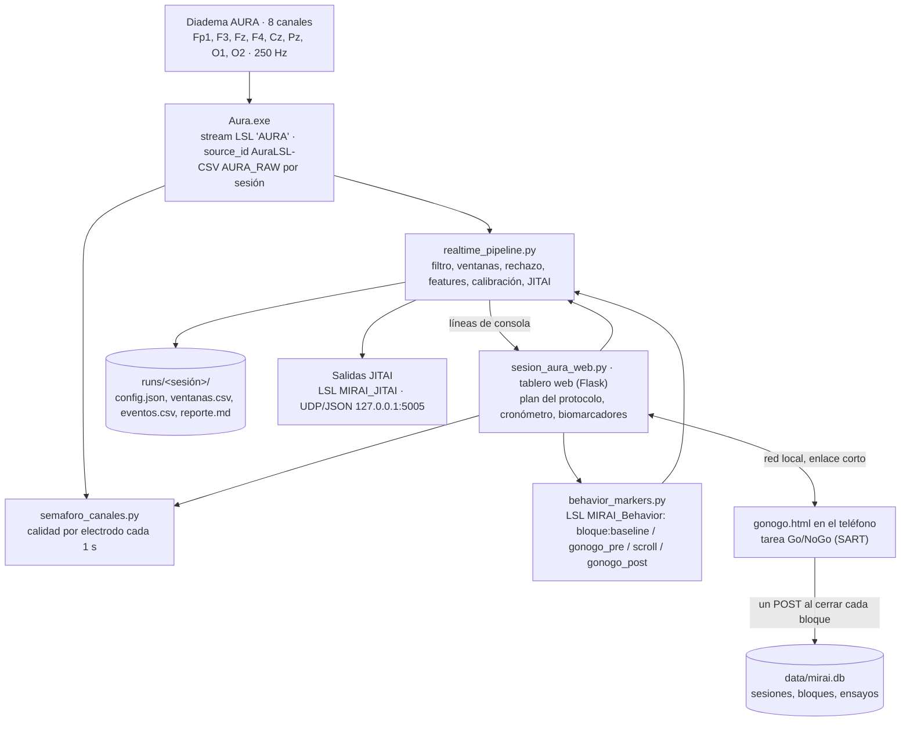

# Plataforma Neuroadaptativa en Realidad Aumentada (AR) y Procesamiento de Señales EEG

**Proyecto de Investigación e Innovación Tecnológica · MIRAI Innovation Training Program (Japón) / Universidad del Caribe**  
*Detección en tiempo real e intervención en lazo cerrado para la mitigación de la fatiga cognitiva y la pérdida de control inhibitorio inducida por el uso prolongado de video corto (*short-form scrolling*).*

---

## Visión general del proyecto

Este repositorio alberga la investigación, el pipeline de adquisición y procesamiento de señales electroencefalográficas (EEG) y la arquitectura de la plataforma neuroadaptativa orientada a mitigar la **fatiga atencional digital**.

A diferencia de aproximaciones basadas en temporizadores estáticos o en la desconexión total del dispositivo, el proyecto propone una **Intervención Adaptativa Justo a Tiempo (*JITAI - Just-In-Time Adaptive Intervention*)** en **Realidad Aumentada (AR)** en lazo cerrado (*closed-loop*). El sistema monitorea la dinámica cerebral del usuario con una diadema EEG no invasiva (AURA) y despliega de forma gradual señales sutiles de concientización (*cues*), fricciones de interacción o pausas restaurativas, sin bloquear el teléfono.

---

## Marco neurocientífico e hipótesis

El proyecto distingue dos dimensiones neurofisiológicas y conductuales:

1. **Fatiga cognitiva tónica (vigilancia / esfuerzo):** modulaciones sostenidas asociadas al agotamiento de recursos atencionales y al desenganche mental (*mind-wandering*).
   * **Theta frontal ($Fz, Cz$):** esfuerzo atencional y control ejecutivo compensatorio.
   * **Alfa posterior periódica ($Pz, O1, O2$):** desactivación sensorial y desenganche cortical, cuantificada separando la oscilación periódica del fondo aperiódico $1/f$ (`specparam` / FOOOF).
   * **Monitoreo ocular ($Fp1$):** frecuencia de parpadeo como variable de fatiga y control de artefactos.

2. **Control inhibitorio fásico (capacidad de detención):** capacidad de frenar impulsos automáticos (p. ej., pasar al siguiente video).
   * **Theta frontal medial evocada (ERSP NoGo):** sincronización fásica tras estímulos que exigen frenar la respuesta (tarea Go/NoGo).
   * **Errores de comisión y tiempos de reacción (TR):** desempeño conductual directo del control prefrontal.

### Hipótesis de investigación
* **H1 (marcadores tónicos):** el scrolling continuo de video corto genera un incremento relativo en la potencia theta frontal y en la alfa periódica posterior respecto a la línea base.
* **H2 (control inhibitorio fásico):** la exposición prolongada al scrolling disminuye la respuesta theta fásica evocada ante eventos NoGo e incrementa la tasa de errores de comisión.
* **H3 (disociación tónico-fásica):** durante la fatiga atencional se observa elevación de la theta tónica en paralelo con una atenuación de la theta fásica ligada a la inhibición (*Arnau et al., 2021*).
* **H4 (validación de ingeniería en lazo cerrado):** la intervención disparada por estados neurales supera a las intervenciones por temporizador. *Aplazada; se conserva como referencia.*

---

## Validación previa en datasets públicos

Antes del estudio propio, el método de análisis se contrastó con tres conjuntos de datos:

| Dataset | Muestra / condiciones | Hallazgos principales | Relevancia |
|---|---|---|---|
| **ds007537 (OpenNeuro)** | $n = 27$ sujetos válidos; 10 min de smartphone (video corto vs. juegos) | En video corto la **alfa periódica aumentó (+0.43 dB, 10/12 sujetos, $p = 0.04$)** y el exponente $1/f$ se empinó, sin indicios de somnolencia por parpadeo. Theta estable. | Firma de **desenganche cortical** en video corto; la alfa "total" oculta el ritmo periódico por la inclinación del fondo $1/f$. |
| **EEG-SVRec (SIGIR 2024)** | $n = 25$ sujetos válidos; 62 canales a 1000 Hz, ~1200 min de video corto | La alfa periódica covaría negativamente con inmersión y arousal por video ($\rho = -0.108, p = 0.0025$). | La alfa funciona como biomarcador de engagement/desenganche ante contenido audiovisual. |
| **Cao 2019 (Figshare)** | $n = 27$ sujetos, 62 sesiones; 60–90 min de conducción sostenida | **Control positivo:** theta tónica acoplada al log TR ($\rho = +0.50$, 25/27) y a lapsos ($\rho = +0.46$). La theta fásica se mantiene (+0.83 dB, 24/27). | El método detecta theta tónica bajo fatiga prolongada; la caída fásica no se confirma (compensación ejecutiva). |

Ningún dataset público combina scrolling activo de video corto, duración suficiente para inducir fatiga (45 min o más) y una sonda inhibitoria integrada. Esa brecha fundamenta el experimento propio.

---

## Pipeline de recolección de EEG

El pipeline de recolección corre en la PC del laboratorio, en `Tests/simulation_B/` (versión B del protocolo de simulación, `Tests/Protocolo_Simulacion_Pipeline.md`). Cada módulo es un proceso independiente; el tablero web los lanza y muestra su salida en vivo, sin fusionarlos.

### Flujo general



### Protocolo de sesión (3180 s)

| Bloque | Inicio | Duración | Qué ocurre |
|---|---|---|---|
| `baseline` | 0 s | 2 min | Ojos abiertos, mirada fija, sin moverse. El pipeline calibra en los primeros 90 s. |
| `gonogo_pre` | 120 s | 3 min | El teléfono del laboratorio inicia solo la tarea Go/NoGo (pre). |
| `scroll` | 300 s | 45 min | Scrolling libre de video corto. |
| `gonogo_post` | 3000 s | 3 min | Tarea Go/NoGo (post). |

Los cambios de bloque se publican como marcadores `bloque:<nombre>` en el stream LSL `MIRAI_Behavior`; el pipeline los usa para el conteo de parpadeos por bloque y el reporte final.

### Etapas del procesamiento en tiempo real (`realtime_pipeline.py`)

1. **Entrada LSL.** El stream se elige por nombre + host local + prefijo de `source_id` (`AuraLSL-` para Aura.exe, `mirai-sim-` para el emulador). `lsl_api.cfg` limita el descubrimiento LSL a la propia PC (`ResolveScope = machine`), para no tomar streams de otras máquinas de la red. Lectura con `pull_chunk(timeout=0)` y espera corta.
2. **Filtro causal con estado.** Butterworth pasa-banda 1–40 Hz (orden 4) más notch a 60 Hz (Q = 30) cuando cabe bajo Nyquist. El estado se conserva entre bloques.
3. **Ventanas.** Ventana de 6 s con avance de 1 s (una evaluación por segundo), cortada en múltiplos exactos del avance.
4. **Chequeo de calidad a los 10 s.** Canales con desviación estándar fuera de 0.05–5 veces la mediana se marcan como malos y se excluyen del rechazo y de las ROI. Si una ROI queda vacía, la sesión se detiene.
5. **Referencia promedio (solo AURA real).** Por ventana, sin Fp1 ni canales malos, para eliminar el 60 Hz de modo común de la diadema. Fp1 se invierte para el contador de parpadeos (en AURA los parpadeos son negativos).
6. **Rechazo de artefactos.** Cada ventana se divide en 9 segmentos de 2 s (paso 0.5 s). Un segmento se descarta si su amplitud pico a pico supera 150 µV en Fp1, F3/F4 o en la ROI. La potencia EMG (25–40 Hz) se mide y registra, pero no descarta segmentos. Más de 5 s sin ventanas válidas se reporta como señal perdida.
7. **Features espectrales (`spectral_features.py`).** Periodograma Hamming por segmento limpio, promediado por ROI (theta: Fz + Cz; alfa: Pz, O1, O2). Ajuste `specparam` en 2–30 Hz para separar la componente periódica del fondo $1/f$. Bandas relativas al IAF individual: theta = IAF − 6 a IAF − 2 Hz, alfa = IAF ± 2 Hz. Una feature es válida si el ajuste tiene $R^2 \ge 0.75$.
8. **Calibración congelada (`calibration.py`).** Durante los primeros 90 s del baseline acumula ventanas válidas; con al menos 45 por feature congela IAF, $\mu$ y $\sigma_Z$ (corregida por autocorrelación). Si no alcanza, extiende 30 s hasta dos veces y después aborta. Luego cada ventana se suaviza con EWMA (theta $\tau$ = 60 s, alfa $\tau$ = 5 s) y se expresa como $Z = (\tilde{x} - \mu) / \sigma_Z$.
9. **Motor JITAI (`jitai.py`).** Escalera de tres niveles con histéresis (entra con $Z \ge 1.5$, sale con $Z < 1.0$) y prioridad 3 > 2 > 1:
   * Nivel 1, cue de conciencia: $Z_\alpha$ sostenido 5 s; refractario 60 s.
   * Nivel 2, fricción: 2 eventos NoGo conductuales en 60 s; refractario 120 s.
   * Nivel 3, pausa restaurativa: $Z_\theta$ sostenido 30 s; refractario 300 s.
   * Bloqueo por calidad: exponente aperiódico bajo $\mu - 3\sigma$ junto con EMG alto.
10. **Contador de parpadeos (Fp1).** Fp1 crudo filtrado 1–10 Hz sin desfase, picos de 40–500 ms separados al menos 0.3 s. El umbral de prominencia se recalcula cada 7 min con los datos de ese periodo.
11. **Registro y reporte.** Cada sesión deja `runs/<AAAAMMDD_HHMMSS>_<fuente>/` con `config.json`, `ventanas.csv` (features, Z, validez, tasa de parpadeo), `eventos.csv` (marcadores, disparos JITAI, parpadeos) y, al detenerse, `reporte.md` con latencias, CPU, memoria, porcentaje de ventanas válidas, disparos y parpadeos por bloque.

### Semáforo de electrodos (`semaforo_canales.py`)

Corre aparte de la sesión con su propio inlet LSL y puede quedarse encendido durante ella. Cada segundo evalúa los últimos 10 s por canal (filtro causal + referencia promedio): verde con $\sigma$ robusta (1.4826 · MAD) hasta 15 µV, amarillo entre 15 y 25 µV o con algún segmento mayor a 150 µV, rojo por encima de 25 µV, canal plano, en el riel de la diadema o con al menos 50 % de segmentos rechazables. Sin muestras durante 3 s, todos los canales pasan a rojo.

### Tarea Go/NoGo (`web/gonogo.html`, `gonogo_db.py`)

* SART de Perzl et al. (2024): dígitos 1–9 blancos sobre fondo negro, 250 ms de estímulo y 1150 ms entre inicios; NoGo = 3 (1 de cada 9). 144 ensayos por bloque (180 s), en vertical, sin retroalimentación.
* Se abre en el navegador del teléfono desde la red local con un enlace corto (`<IP>:8000/<clave>`); el teléfono solo tiene acceso a la tarea, no al tablero.
* Sincronización de reloj tipo NTP al inicio y al final del bloque para llevar el inicio de cada estímulo al reloj LSL y alinearlo con el EEG.
* Todos los ensayos se envían en un solo POST al terminar el bloque (sin red durante la tarea). El servidor clasifica cada ensayo a partir de su propia secuencia y lo guarda en SQLite (`data/mirai.db`, fuera de git).
* El tablero muestra el estado de la tarea, un bloque de práctica y la vista de resultados (`/resultados`) con exportación a CSV.
* Los participantes se identifican solo con un código (sin datos personales).

### Fuentes de datos alternativas

* `mock_lsl_streamer.py` emula la diadema por LSL (señal sintética o replay de ds007537, EEG-SVRec o CSV de AURA) para probar el pipeline sin hardware.
* `realtime_pipeline.py --offline <archivo>` pasa una grabación por el mismo código sin LSL, por ejemplo un `AURA_RAW___<fecha>.csv` de `Tests/Recordings/`.

---

## Estructura del repositorio

```text
Project/
├── AURA/                                   # SDK y software de la diadema (fuera de git)
├── Documentación/                          # Propuesta, presentaciones y análisis de alcance
│   ├── Analisis_Scope_v2.md
│   ├── Resumen_Sesion_21_10.md
│   └── Project Proposal / Progress Report  # .pptx y .pdf
├── Tests/
│   ├── simulation_B/                       # Pipeline de recolección actual (versión B)
│   │   ├── sesion_aura_web.py              # Tablero web: lanza módulos, protocolo, Go/NoGo, resultados
│   │   ├── servidor_web.bat                # Inicio con doble clic (modo red local)
│   │   ├── realtime_pipeline.py            # Procesamiento en tiempo real (Pasos 2-7)
│   │   ├── spectral_features.py            # PSD + specparam por ROI
│   │   ├── calibration.py                  # Chequeo de calidad y calibración congelada
│   │   ├── jitai.py                        # Escalera de intervención
│   │   ├── semaforo_canales.py             # Semáforo de electrodos
│   │   ├── behavior_markers.py             # Marcadores de bloque y conducta por LSL
│   │   ├── check_lsl_stream.py             # Identificación del stream (find_stream)
│   │   ├── mock_lsl_streamer.py            # Emulador LSL y lectores de archivos
│   │   ├── run_simulation.py               # Lanzador emulador + pipeline y benchmark (Paso 7)
│   │   ├── replay_offline.py               # Rechazo de artefactos sobre grabaciones reales (Pasos 2-3)
│   │   ├── gonogo_db.py                    # Base SQLite de la tarea Go/NoGo
│   │   ├── test_gonogo.py                  # Prueba de la tarea Go/NoGo con sesión simulada
│   │   ├── sesion_aura.py                  # Lanzador de escritorio anterior (tkinter), histórico
│   │   ├── web/                            # sesion_aura.html (tablero) y gonogo.html (teléfono)
│   │   ├── lsl_api.cfg                     # LSL limitado a esta PC
│   │   ├── requirements.txt
│   │   ├── data/                           # mirai.db y claves de acceso (fuera de git)
│   │   └── runs/                           # Registro por sesión (fuera de git)
│   ├── simulation/                         # Versión A del pipeline, histórica
│   ├── datasets workflow/                  # Análisis de datasets públicos
│   │   ├── ds007537/                       # h1_ds007537.py (también lo usa spectral_features.py)
│   │   ├── EEG-SVRec/                      # h1_svrec.py
│   │   ├── Cao2019/                        # h1b_cao2019.py
│   │   └── EEG Dataset 9-10/               # Visor interactivo y guía de canales 10-20
│   ├── Recordings/                         # CSV de Aura.exe por sesión (fuera de git)
│   ├── Protocolo_Simulacion_Pipeline.md    # Protocolo técnico Pasos 1-7
│   ├── Diagrama_Pipeline.md                # Diagrama detallado del pipeline
│   ├── AURA_Configuracion.md               # Configuración de la diadema y Aura.exe
│   ├── Plan_App_GoNoGo.md                  # Plan y fases de la tarea Go/NoGo
│   ├── Plan_Avances.md                     # Plan metodológico y fases
│   └── Revision_Literatura_Hipotesis.md    # Justificación teórica y referencias
├── graphify-out/                           # Grafo de conocimiento del repositorio
├── CLAUDE.md
└── README.md
```

---

## Instalación y uso

### 1. Entorno de Python
Python 3.10 o superior (probado con 3.14 y pylsl 1.18):
```bash
pip install -r Tests/simulation_B/requirements.txt
pip install pandas matplotlib specparam
```
`specparam` y `pandas` son necesarios porque `spectral_features.py` usa el ajuste de `h1_ds007537.py`.

### 2. Sesión con la diadema AURA
1. Abrir Aura.exe, conectar la diadema y verificar que publica el stream `AURA` (ver `Tests/AURA_Configuracion.md`).
2. Iniciar el tablero con doble clic en `Tests/simulation_B/servidor_web.bat`, o desde una terminal:
   ```bash
   python Tests/simulation_B/sesion_aura_web.py --lan
   ```
3. En el tablero (`http://localhost:8000`): encender el semáforo de electrodos, capturar el código del participante e iniciar la sesión. Abrir en el teléfono el enlace que muestra la tarjeta Go/NoGo.
4. Al terminar, detener la sesión desde el tablero para que el pipeline escriba `reporte.md`.

### 3. Pipeline sin tablero
```bash
python Tests/simulation_B/realtime_pipeline.py --name AURA --source-id AuraLSL-
```
```bash
python Tests/simulation_B/mock_lsl_streamer.py
```
```bash
python Tests/simulation_B/realtime_pipeline.py --offline "Tests/Recordings/<fecha>/AURA_RAW___<fecha>.csv"
```

### 4. Prueba de la tarea Go/NoGo
```bash
python Tests/simulation_B/test_gonogo.py
```

### 5. Análisis de datasets públicos
```bash
python "Tests/datasets workflow/ds007537/h1_ds007537.py" "RUTA_A_DATASET/ds007537"
```
```bash
python "Tests/datasets workflow/EEG-SVRec/h1_svrec.py" "RUTA_A_DATASET/EEG-SVRec"
```
```bash
python "Tests/datasets workflow/Cao2019/h1b_cao2019.py" "RUTA_A_DATASET/Cao2019"
```

Los datos crudos (EEG, grabaciones de Aura.exe, base de la tarea) no se incluyen en git.

---

## Hoja de ruta

- [x] **Fase 1 · Marco teórico y validación en datasets públicos:** ds007537, EEG-SVRec y control positivo con Cao 2019.
- [x] **Fase 2 · Pipeline en tiempo real:** emulador LSL, filtrado, rechazo, specparam, calibración, JITAI y reporte (Pasos 1-7).
- [x] **Fase 3 · Sesiones con la diadema AURA:** tablero web, semáforo de electrodos, referencia promedio y siete sesiones registradas.
- [ ] **Fase 4 · Tarea Go/NoGo:** base de datos, rutas del servidor, app del teléfono e integración al tablero listas; pendiente la validación de tiempos en el teléfono real y la sesión completa de extremo a extremo.
- [ ] **Fase 5 · Prototipo AR en lazo cerrado:** puente LSL/UDP hacia el motor AR para la escalera de intervención.

---

## Autor e institución

* **Ricardo Monrreal Pool**  
  *Ingeniería en Datos e Inteligencia Organizacional* — **Universidad del Caribe** (Cancún, México)  
  *Participante del MIRAI Innovation Training Program* (Osaka / Tokio, Japón)
