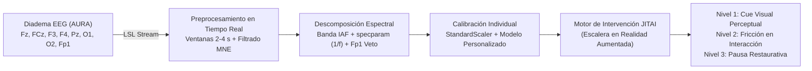

# Plataforma Neuroadaptativa en Realidad Aumentada (AR) y Procesamiento de Señales EEG

**Proyecto de Investigación e Innovación Tecnológica · MIRAI Innovation Training Program (Japón) / Universidad del Caribe**  
*Detección en tiempo real e intervención en lazo cerrado para la mitigación de la fatiga cognitiva y la pérdida de control inhibitorio inducida por el uso prolongado de video corto (*short-form scrolling*).*

---

## 📌 Visión General del Proyecto

Este repositorio alberga la investigación, el desarrollo del pipeline de procesamiento de señales electroencefalográficas (EEG) y la arquitectura de la plataforma neuroadaptativa orientada a mitigar la **fatiga atencional digital**.

A diferencia de aproximaciones tradicionales basadas en temporizadores estáticos o en la desconexión total del dispositivo, este proyecto propone una **Intervención Adaptativa Justo a Tiempo (*JITAI - Just-In-Time Adaptive Intervention*)** en **Realidad Aumentada (AR)** en lazo cerrado (*closed-loop*). El sistema monitorea la dinámica cerebral del usuario mediante una diadema EEG no invasiva y despliega de manera gradual señales sutiles de concientización (*cues*), fricciones de interacción o pausas restaurativas, sin necesidad de bloquear el teléfono inteligente.

---

## 🔬 Marco Neurocientífico e Hipótesis

El proyecto distingue con precisión dos dimensiones neurofisiológicas y conductuales:

1. **Fatiga Cognitiva Tónica (Vigilancia / Esfuerzo):** Modulaciones sostenidas en el tiempo asociadas al agotamiento de recursos atencionales y al desenganche mental (*mind-wandering*).
   * **Theta Frontal ($Fz, FCz$):** Indicador de esfuerzo atencional y control ejecutivo compensatorio.
   * **Alfa Posterior Periódica ($Pz, O1, O2$):** Marcador de desactivación sensorial y desenganche cortical, cuantificado separando la oscilación periódica del fondo aperiódico $1/f$ (`specparam` / FOOOF).
   * **Asimetría Alfa Frontal (FAA: $F3, F4$):** Dinámica motivacional y de aproximación/evitación.
   * **Monitoreo Ocular ($Fp1$):** Frecuencia de parpadeos para controlar la somnolencia y prevenir falsos positivos.

2. **Control Inhibitorio Fásico (Capacidad de Detención):** Capacidad de frenar impulsos automáticos (p. ej., pasar al siguiente video o *swipe* impulsivo).
   * **Theta Frontal Medial Evocado ($ERSP$ NoGo):** Potenciación de sincronización fásica tras estímulos que demandan frenado cognitivo (*Go/NoGo* o sondas *Scroll-NoGo* dentro de la navegación).
   * **Errores de Comisión y Tiempos de Reacción (TR):** Desempeño conductual directo del sistema de control prefrontal.

### Hipótesis de Investigación
* **H1 (Marcadores Tónicos):** El scrolling continuo de video corto genera un incremento relativo en la potencia theta frontal y en la actividad alfa periódica posterior respecto a una condición de control pasiva no fatigante (documental neutro).
* **H2 (Control Inhibitorio Fásico):** La exposición prolongada al scrolling disminuye la respuesta theta fásica evocada ante eventos NoGo e incrementa la tasa de errores de comisión.
* **H3 (Disociación Tónico-Fásica):** Durante la fatiga atencional se produce una disociación observable: elevación de la actividad theta tónica basal en paralelo con una atenuación de la respuesta theta fásica ligada a la inhibición (*Arnau et al., 2021*).
* **H4 (Validación de Ingeniería en Lazo Cerrado):** La intervención neuroadaptativa en AR disparada por estados neurales individuales supera significativamente a las intervenciones tradicionales basadas en temporizadores estáticos en efectividad y adherencia.

---

## 📊 Avances y Validación Empírica en Datasets Públicos

Como fase previa al estudio experimental propio, el pipeline fue contrastado frente a tres conjuntos de datos neurofisiológicos clave:

| Dataset | Muestra / Condiciones | Hallazgos Principales | Relevancia para el Proyecto |
|---|---|---|---|
| **ds007537 (OpenNeuro)** | $n = 27$ sujetos válidos<br>10 min de smartphone (video corto vs. juegos) | En video corto, la **alfa periódica aumentó significativamente (+0.43 dB, 10/12 sujetos, $p = 0.04$)** y el exponente $1/f$ se empinó, sin indicios de somnolencia por parpadeo. Theta se mantuvo estable. | Revela una firma nítida de **desenganche cortical / fatiga pasiva** en video corto. Confirma que la potencia alfa "total" oculta el ritmo periódico debido a la inclinación del fondo $1/f$. |
| **EEG-SVRec (SIGIR 2024)** | $n = 25$ sujetos válidos<br>62 canales a 1000 Hz, ~1200 min de video corto | La alfa periódica covaría negativamente con el nivel de inmersión y arousal reportado por video ($\rho = -0.108, p = 0.0025$). | Ratifica el papel de la banda alfa como biomarcador de engagement/desenganche en tiempo real ante contenido audiovisual dinámico. |
| **Cao 2019 (Figshare)** | $n = 27$ sujetos, 62 sesiones válidas<br>60–90 min conducción sostenida | **Control positivo:** Fuerte acople theta tónico con log TR ($\rho = +0.50$, 25/27) y lapsos ($\rho = +0.46$). La respuesta fásica theta se mantiene robusta (+0.83 dB, 24/27) compensando la fatiga. | Demuestra que el pipeline detecta de forma reproducible el theta tónico bajo fatiga prolongada y valida el modelo de compensación ejecutiva. |

### Brecha Identificada en el Estado del Arte
Ningún estudio o dataset público a la fecha combina de forma simultánea:
1. Navegación activa en video corto (*scrolling*).
2. Duración de sesión suficiente para inducir fatiga ($\ge 45\text{--}60$ minutos).
3. Sonda inhibitoria integrada (*Scroll-NoGo*).
4. Condición de control balanceada (documental neutro).

Este hallazgo fundamenta el diseño del **experimento propio** y la originalidad del proyecto.

---

## 📁 Estructura del Repositorio

```text
Project/
│
├── AURA/                                  # Módulos de hardware y adquisición de señal
│   └── AURA_Software/
│       ├── AURA_SDK/                      # SDK y librerías de enlace con la diadema AURA
│       └── VRehab.py                      # Streaming vía LSL y pipeline de calibración individual
│
├── Tests/                                 # Datasets experimentales, pipelines de análisis y reportes
│   ├── ds007537/                          # Análisis del dataset de smartphone en OpenNeuro
│   │   ├── h1_ds007537.py                 # Pipeline de extracción espectral, specparam y parpadeo
│   │   ├── Reporte_H1_ds007537.md         # Reporte técnico detallado de resultados
│   │   └── results/                       # CSVs de métricas por minuto, figuras y estadísticas
│   │
│   ├── EEG-SVRec/                         # Análisis del dataset EEG en video corto (SIGIR 2024)
│   │   ├── h1_svrec.py                    # Pipeline adaptado a 62 canales con control EMG
│   │   ├── Reporte_H1_SVRec.md            # Reporte de resultados de inmersión y trayectorias
│   │   └── results/                       # Gráficas espectrales y coeficientes de correlación
│   │
│   ├── Cao2019/                           # Control positivo de fatiga sostenida (60–90 min)
│   │   ├── h1b_cao2019.py                 # Pipeline de acople tónico-conductual y análisis fásico ERSP
│   │   └── results/                       # Registro estadístico y curvas temporales
│   │
│   ├── EEG Dataset 9-10/                  # Visor y herramientas interactivas
│   │   ├── Demo_processing.py             # Visor interactivo EEG con modulación dinámica de canales
│   │   ├── Guia_Canales_y_Datasets.md     # Documentación técnica de canales 10-20 y biomarcadores
│   │   └── raw_data/                      # Directorio local para almacenamiento de señales brutas
│   │
│   ├── Analisis_Scope_v2.md               # Análisis exhaustivo del marco científico, pipeline y JITAI
│   ├── Plan_Avances.md                    # Plan metodológico, contingencia ante resultados nulos y fases
│   ├── Revision_Literatura_Hipotesis.md   # Justificación teórica y referencias bibliográficas
│   ├── Guia_Exposicion.md                 # Guía narrativa y apoyo para presentaciones
│   ├── Resumen_Sesion_21_10.md            # Bitácora ejecutiva de decisiones y resultados
│   └── Project Proposal MIRAI Ricardo_Monrreal.pptx # Presentación de propuesta del proyecto
│
├── Benkyokai-oct/                         # Proyectos de estudio, retos de IA y backend
│   ├── fastapi/                           # Módulos y servicios de soporte API
│   └── Reto-IA/                           # Desarrollos experimentales de inteligencia artificial
│
├── graphify-out/                          # Grafo de conocimiento y dependencias del repositorio
├── CLAUDE.md                              # Guía técnica de interacción con el knowledge graph
├── .gitignore                             # Exclusiones de Git (datos crudos, temporales y modelos)
└── README.md                              # Documentación general del repositorio
```

---

## 🛠️ Arquitectura Tecnológica y Lazo Cerrado



* **Adquisición:** Streaming continuo mediante *Lab Streaming Layer* (LSL).
* **Procesamiento de Señales:** MNE-Python, SciPy y `specparam` (FOOOF) para aislamiento de oscilaciones periódicas libres del sesgo $1/f$.
* **Robustez de Ingeniería:** El sistema de lazo cerrado se desacopla del resultado poblacional de las hipótesis científicas: utiliza una calibración individualizada por sesión basada en desempeño conductual y puede respaldarse mediante un disparador híbrido (EEG + velocidad de scroll / tiempo de sesión).

---

## 🚀 Instalación y Puesta en Marcha

### 1. Clonar el repositorio
```bash
git clone https://github.com/Ricardomonrreal/MIRAI-2026-Project-Own.git
cd Project
```

### 2. Configurar el entorno virtual de Python
Se recomienda Python 3.10+:
```bash
python -m venv venv
# En Windows:
venv\Scripts\activate
# En Linux/macOS:
source venv/bin/activate

pip install numpy scipy pandas matplotlib mne specparam scikit-learn pylsl
```

### 3. Ejecutar los pipelines de análisis

* **Análisis de H1 en ds007537:**
  ```bash
  python "Tests/ds007537/h1_ds007537.py" "RUTA_A_DATASET/ds007537"
  ```
* **Análisis de inmersión en EEG-SVRec:**
  ```bash
  python "Tests/EEG-SVRec/h1_svrec.py"
  ```
* **Control positivo y análisis fásico en Cao 2019:**
  ```bash
  python "Tests/Cao2019/h1b_cao2019.py"
  ```

### 4. Lanzar el Visor Interactivo de Señales
El script `Demo_processing.py` incluye una interfaz gráfica para inspeccionar señales EEG, mapa visual del montaje 10-20, detección dinámica de canales y cálculo automático de métricas:
```bash
python "Tests/EEG Dataset 9-10/Demo_processing.py"
```

> **Nota sobre los datos crudos (`raw_data`):** Los archivos EEG voluminosos no se incluyen en el repositorio Git. Para replicar los análisis locales, sitúe los registros en las carpetas `raw_data` correspondientes siguiendo las pautas de [Guia_Canales_y_Datasets.md](file:///c:/Users/ricar/Documents/Ucaribe/MIRAI%202026/Project/Tests/EEG%20Dataset%209-10/Guia_Canales_y_Datasets.md).

---

## 🗺️ Hoja de Ruta (Roadmap)

- [x] **Fase 1 · Marco Teórico y Validación en Datasets Públicos:** Procesamiento de ds007537, EEG-SVRec y control positivo con Cao 2019.
- [x] **Fase 2 · Pipeline y Visor Interactivo:** Normalización de canales 10-20, estimación de $1/f$ y visualización gráfica.
- [ ] **Fase 3 · Experimento de Laboratorio Propio:** 
  - Prerregistro en Open Science Framework (OSF).
  - Protocolo de 45–60 min de scrolling vs. documental neutro ($n \approx 10\text{--}15$ piloto).
  - Tarea *Scroll-NoGo* integrada y evaluación de esfuerzo cognitivo (KSS / NASA-TLX).
- [ ] **Fase 4 · Prototipo AR en Lazo Cerrado:**
  - Simulador LSL con señales precargadas.
  - Puente LSL $\rightarrow$ motor AR (Unity / WebXR) para despliegue de la escalera de intervención neuroadaptativa.
  - Prueba de concepto en tiempo real validada mediante modulación alfa por cierre ocular (efecto Berger).

---

## 👤 Autor e Institución

* **Ricardo Monrreal Pool**  
  *Ingeniería en Datos e Inteligencia Organizacional* — **Universidad del Caribe** (Cancún, México)  
  *Participante del MIRAI Innovation Training Program* (Osaka / Tokio, Japón)