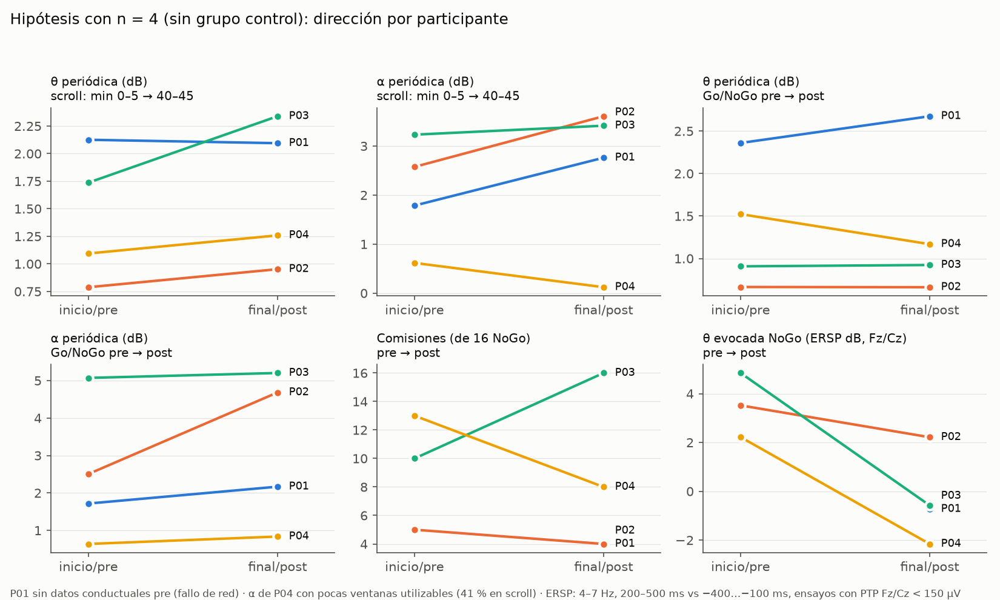
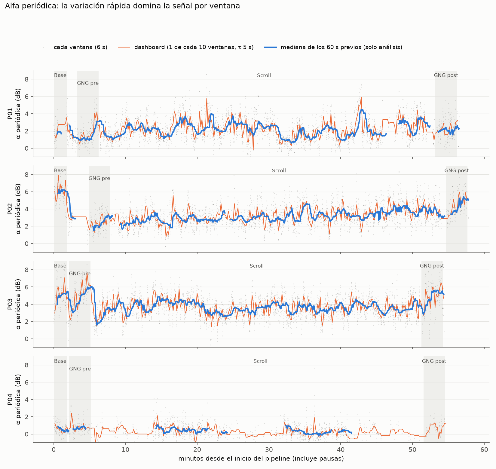

# Análisis de las sesiones P01–P04 (19 nov 2026)

Cuatro participantes, una sesión cada uno, con el mismo protocolo: **baseline 2 min → Go/NoGo pre 3 min → scroll 45 min → Go/NoGo post 3 min**. No hay grupo control (documental), así que todo lo que sigue es **dirección por participante**, no una prueba de hipótesis.

## En pocas palabras

- **La señal ya es buena.** P03 y P04 tuvieron 97–99 % de ventanas válidas y sin pérdida de muestras. P01 fue la sesión con problemas técnicos (Wi-Fi, F4, carga de la PC).
- **H1 (fatiga tónica durante el scroll): no hay un patrón común.** La theta sube con claridad solo en P03 y la alfa solo en P02. Los otros dos están planos.
- **La alfa sí sube del Go/NoGo pre al post en los 4**, pero sin control no se puede atribuir al scroll: también sube por cansancio general o por llevar una hora sentado.
- **H2 (pérdida de control inhibitorio): resultados opuestos.** P03 empeora mucho, P04 mejora y P02 se queda igual. P01 no tiene bloque pre.
- **La theta evocada por el NoGo baja del pre al post en los 3 con datos**, pero también baja en los ensayos Go. La respuesta específica del NoGo (NoGo − Go) baja en P03 y P04 y se mantiene en P02.
- **H3 (theta tónica ↑ y fásica ↓ a la vez): solo P03 la cumple.**
- **La alfa de P04 es poco confiable.** En el scroll solo el 41 % de sus ventanas tuvo un ajuste espectral aceptable. Tiene poca alfa de origen y, además, actividad muscular durante la tarea (sobre todo en O2, junto al cuello). Su theta sí es usable.

## 1. Calidad de cada sesión

| | Ventanas válidas | IAF | Muestras perdidas | Latencia p95 | Intervenciones | Notas |
|---|---|---|---|---|---|---|
| **P01** | 89.0 % | 8.5 Hz | 1.2 % | 3127 ms | N1 ×29 | Baseline ruidoso (O2), F4 desconectado ~100 ventanas, PC cargada, Go/NoGo pre perdido por Wi-Fi |
| **P02** | 90.0 % | 8.5 Hz | 0.4 % | 857 ms | N3 ×5 | Las inválidas son casi todas por parpadeos/movimiento ocular |
| **P03** | 98.8 % | 10 Hz | 0 % | 391 ms | N1 ×1, N3 ×1 | Sesión limpia |
| **P04** | 96.8 % | 10 Hz | 0 % | 341 ms | N1 ×8 | Sesión limpia; alfa débil (ver abajo) |

**El caso de la alfa de P04.** El pipeline solo acepta la alfa de una ventana si el ajuste del espectro (specparam) explica al menos el 75 % de la forma del espectro (R² ≥ 0.75). En P04 las ventanas aceptadas bajan de 72 % en el baseline a 56 % en el pre, 41 % en el scroll y 31 % en el post. Hay dos causas que se suman:

1. **Alfa débil de origen.** Su alfa periódica del baseline es 0.6 dB, frente a 1.8–5.5 dB en los demás. Es una diferencia individual: hay personas con poca alfa, sobre todo con ojos abiertos.
2. **Actividad muscular durante la tarea, sobre todo en O2.** Su índice EMG pasa de −7.3 dB en el baseline a −1.9 dB en el scroll y −2.7 dB en el post; en P03 no se mueve de −9.5. La potencia de 25–40 Hz sube +9.5 dB en O2, y la re-referencia promedio (CAR) la reparte entre los demás canales (+2 a +5 dB). O2 queda sobre los músculos del cuello: encaja con tener la cabeza inclinada hacia el teléfono.

**Por qué el músculo tumba el R².** La actividad muscular levanta las frecuencias altas y aplana el espectro (exponente 1.24 → 0.82). Con un espectro plano casi no hay forma que explicar (la varianza baja a la mitad). Aunque el error del ajuste es casi el mismo que en P03 (0.10 frente a 0.08), el R² cae por debajo de 0.75. Dentro de P04, las ventanas con menos EMG se aceptan en un 96 % y las de más EMG en un 12 %.

Por eso la línea de alfa de P04 tiene tantos huecos, y su Zα (σ_Z 0.35) se mueve mucho por poca señal.

## 2. Biomarcadores por bloque

Mediana de cada bloque en dB (solo ventanas con ajuste aceptado).

| | | Baseline | GNG pre | Scroll | GNG post |
|---|---|---|---|---|---|
| **P01** | θ periódica | 3.83* | 2.36 | 2.15 | 2.67 |
| | α periódica | 2.06* | 1.72 | 2.07 | 2.17 |
| **P02** | θ periódica | 1.82 | 0.66 | 0.85 | 0.66 |
| | α periódica | 5.98 | 2.51 | 3.08 | 4.68 |
| **P03** | θ periódica | 0.72 | 0.91 | 2.06 | 0.92 |
| | α periódica | 5.00 | 5.07 | 3.57 | 5.20 |
| **P04** | θ periódica | 1.48 | 1.52 | 1.17 | 1.17 |
| | α periódica | 0.58 | 0.64 | 0.33† | 0.84† |

\* Baseline de P01 con solo 46 % de ventanas válidas. † Con pocas ventanas utilizables.

**El baseline no se parece a la tarea.** En P02 la alfa del baseline (6 dB) es mucho mayor que en cualquier tarea, así que su Zα sale negativo toda la sesión. En P03 la theta sube de golpe al empezar el scroll y vuelve a bajar en el post: es un cambio de estado por la tarea (mirar el teléfono, mover los ojos), no fatiga acumulada. **Hoy el Z frente al baseline mide sobre todo "qué tan distinta es la tarea del reposo".**

## 3. Hipótesis

### H1 — fatiga tónica durante el scroll (θ y α periódicas suben con el tiempo)

Comparación de los minutos 0–5 contra los 40–45 del scroll. ρ es la correlación de Spearman entre el minuto y la mediana de ese minuto.

| | θ periódica (H1b) | | α periódica (H1a) | |
|---|---|---|---|---|
| **P01** | 2.10 → 2.03 | ρ +0.06, p 0.70 — plana | 1.69 → 2.87 | ρ +0.05, p 0.73 — solo sube al final |
| **P02** | 0.75 → 0.92 | ρ +0.24, p 0.11 — sube, n.s. | 2.49 → 3.59 | **ρ +0.69, p < 0.001 — sube** |
| **P03** | 1.82 → 2.39 | **ρ +0.40, p 0.006 — sube** | 3.44 → 3.44 | ρ −0.06, p 0.69 — plana |
| **P04** | 1.04 → 1.23 | ρ −0.01, p 0.96 — plana | 0.65 → −0.40† | ρ −0.22, p 0.14 — baja, n.s. |

**Lectura:** cada participante que muestra algo lo muestra en una sola banda, y en una distinta (P03 en theta, P02 en alfa). Con 4 personas no hay tendencia común.

Del Go/NoGo pre al post:

| | θ periódica | α periódica |
|---|---|---|
| P01 | 2.36 → 2.67 (↑) | 1.72 → 2.17 (↑ +0.45) |
| P02 | 0.66 → 0.66 (=) | 2.51 → 4.68 (↑ +2.17) |
| P03 | 0.91 → 0.92 (=) | 5.07 → 5.20 (↑ +0.13) |
| P04 | 1.52 → 1.17 (↓) | 0.64 → 0.84 (↑ +0.20)† |

**La alfa sube en 4 de 4.** Es el resultado más consistente hasta ahora, pero sin la condición documental no se sabe si es por el scroll o por el tiempo en el laboratorio.

### H2 — pérdida de control inhibitorio (Go/NoGo pre → post)

Cada bloque tiene 144 ensayos: 128 Go y 16 NoGo (el estímulo "3"), con un estímulo cada 1150 ms.

| | Bloque | Aciertos Go | Omisiones | Anticipaciones (< 100 ms) | **Comisiones (de 16 NoGo)** | TR mediano | Variabilidad del TR (CV) | d′ |
|---|---|---|---|---|---|---|---|---|
| **P01** | pre | — | — | — | — | — | — | — |
| | post | 126 | 0 | 2 | **4** | 333 ms | 0.23 | 2.83 |
| **P02** | pre | 126 | 1 | 1 | **5** | 376 ms | 0.24 | 2.64 |
| | post | 126 | 0 | 2 | **4** | 342 ms | 0.14 | 2.83 |
| **P03** | pre | 103 | 6 | 19 | **10** | 263 ms | 0.25 | 0.54 |
| | post | 73 | 15 | 40 | **16** | 257 ms | 0.72 | −1.69 |
| **P04** | pre | 123 | 3 | 2 | **13** | 315 ms | 0.35 | 0.87 |
| | post | 126 | 1 | 1 | **8** | 346 ms | 0.25 | 2.15 |

P01 no tiene pre porque el bloque se perdió por la red. d′ mide qué tan bien distingue Go de NoGo: más alto es mejor.

**Lectura por participante:**
- **P02:** desempeño estable y bueno. Sin cambio.
- **P03:** empeora mucho (comisiones 10 → 16, es decir, falla todos los NoGo del post). Las anticipaciones se duplican (19 → 40) y las omisiones suben (6 → 15). Está tocando la pantalla al ritmo fijo de 1150 ms sin mirar el estímulo, un patrón de respuesta automática. Es lo que predice H2, pero también puede ser aburrimiento o estrategia.
- **P04:** mejora (comisiones 13 → 8) y se vuelve más lento (315 → 346 ms). Cambió velocidad por precisión, que es lo contrario de H2 (posible efecto de práctica).

### Theta evocada por el NoGo (parte fásica de H2/H3)

Potencia theta (4–7 Hz) en Fz/Cz de 200 a 500 ms después del estímulo, frente a −400…−100 ms antes. Excluye ensayos con artefacto (> 150 µV).

| | NoGo pre | NoGo post | Go pre | Go post | NoGo − Go pre | NoGo − Go post |
|---|---|---|---|---|---|---|
| P01 | — | −0.73 | — | −0.46 | — | −0.27 |
| P02 | 3.52 | 2.22 | 0.54 | −1.23 | **+2.97** (p 0.03) | **+3.45** (p 0.04) |
| P03 | 4.85 | −0.58 | 3.26 | −1.03 | +1.59 | +0.45 |
| P04 | 2.22 | −2.16 | 0.69 | −0.75 | +1.53 | −1.40 |

(dB; n ≈ 11–16 NoGo por bloque)

**Lectura:** la respuesta al NoGo baja del pre al post en los 3 que tienen ambos bloques. Pero **también baja en los Go**, así que parte del efecto es general (por ejemplo, otra línea base pre-estímulo). La respuesta *propia* del NoGo (NoGo − Go) se mantiene en P02 y baja en P03 y P04. Con 16 NoGo por bloque solo la diferencia de P02 es significativa; lo demás es exploratorio. En P03 casi todos los NoGo del post fueron comisiones, así que su theta mezcla "no frenar" con "frenar".

### H3 — disociación (theta tónica ↑ y fásica ↓)

| | Tónica ↑ en scroll | NoGo − Go ↓ | ¿H3? |
|---|---|---|---|
| P01 | No | Sin pre | No evaluable |
| P02 | Ligera (n.s.) | No (se mantiene) | No |
| P03 | **Sí** (p 0.006) | **Sí** | **Sí** |
| P04 | No | Sí | No (solo la parte fásica) |

## 4. Resumen de hipótesis

| Hipótesis | A favor | En contra / sin cambio | Estado |
|---|---|---|---|
| H1b — θ tónica ↑ en scroll | P03 | P01, P04 planas; P02 n.s. | Sin patrón común |
| H1a — α periódica ↑ en scroll | P02 | P01 n.s., P03 plana, P04 ↓ (poco confiable) | Sin patrón común |
| α periódica ↑ pre → post | 4 de 4 | — | Consistente, sin control |
| H2 — comisiones ↑ | P03 | P02 igual, P04 mejora | Opuesto entre participantes |
| H2 — NoGo − Go ↓ | P03, P04 | P02 | Exploratorio (16 NoGo por bloque) |
| H3 — disociación | P03 | P02, P04 | 1 de 3 evaluables |

**En conjunto:** con 4 participantes y sin control, los datos **no confirman ni descartan** H1–H3. Lo único consistente es la subida de alfa del pre al post. La variabilidad entre personas es grande (P03 se vuelve impulsivo, P04 más cuidadoso), y eso justifica el diseño con modelos mixtos y la condición documental.

## 5. Figuras

Cada línea es un participante: inicio contra final del scroll y Go/NoGo pre contra post.

Puntos grises: cada ventana. Línea naranja: lo que dibuja el dashboard (1 de cada 10 ventanas, suavizado de 5 s). Línea azul: mediana de los 60 s previos, solo para este análisis. Los huecos azules son tramos con menos de 30 ventanas utilizables por minuto (en P04, la mayor parte de la sesión).

## 6. Qué conviene revisar para las próximas sesiones

1. **Sesiones con documental** (condición control). Sin ellas, la subida de alfa pre → post no se puede atribuir al scroll.
2. **El Go/NoGo invita a responder al ritmo** (SOA fijo de 1150 ms): P03 anticipó 40 veces. Un SOA variable (por ejemplo 1000–1300 ms) rompería el ritmo.
3. **El baseline no representa la tarea.** Conviene interpretar las tendencias dentro del scroll (minuto a minuto) y no el Z frente al baseline. Otra opción es calibrar con los primeros minutos del scroll.
4. **Postura y músculo (como en P04).** Conviene poner el teléfono en un soporte a la altura de los ojos para que el cuello no se tense, y vigilar el aviso de EMG/ruido en O1/O2 durante la sesión. Además conviene definir de antemano un criterio de exclusión para alfa (por ejemplo, menos del 50 % de ventanas con ajuste aceptado) y usar solo la theta de esa persona.
5. **Medidas subjetivas** (KSS / NASA-TLX) antes y después, para anclar "fatiga" a algo más que el EEG.

---

*Datos: `Tests/simulation_B/runs/` (carpetas del pipeline y `grabacion_P0x`) y `Tests/simulation_B/data/mirai.db` (Go/NoGo). Medianas por bloque: solo ventanas válidas con ajuste aceptado (R² ≥ 0.75). Tendencias del scroll: mediana por minuto, solo minutos con > 50 % de ventanas válidas. Las pendientes de la figura usan las ventanas directamente, por eso difieren unas centésimas de la tabla.*
