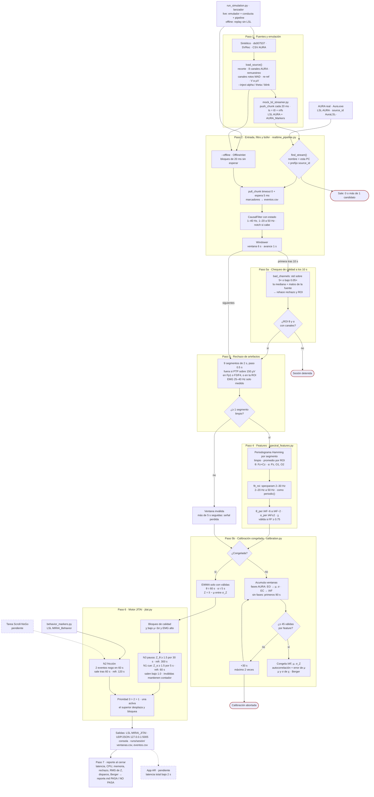

# Diagrama de flujo del pipeline (versión B, 2 nov 2026)

Estado del código en `Tests/simulation_B/` tras los Pasos 1–7 del protocolo. Línea discontinua = pendiente;
borde rojo = la sesión se detiene. Fuera del lazo quedan `test_realtime_pipeline.py` (chequeos offline) y
`replay_offline.py --equivalencia` (comparación con `results/h1_por_minuto.csv`).

