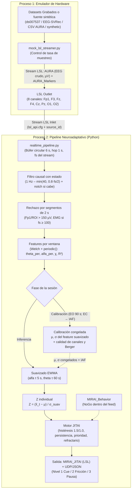
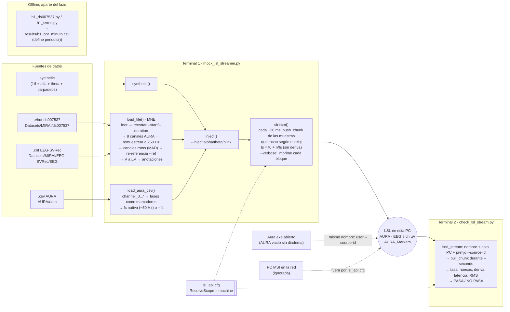
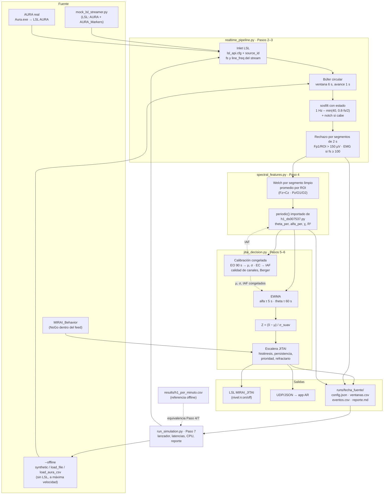

# Protocolo Técnico de Simulación y Pipeline en Tiempo Real (MIRAI 2026)

**Objetivo:** Validar el pipeline de procesamiento de señales EEG en tiempo real, el cálculo de biomarcadores periódicos libres de sesgo $1/f$, la calibración individual y la lógica de intervención neuroadaptativa (JITAI) mediante streaming LSL con datasets grabados (`ds007537`, `EEG-SVRec` y el CSV de prueba de AURA), previo a las pruebas en vivo con la diadema AURA.

---

## 🏗️ 1. Arquitectura del Lazo Cerrado Simulado

El sistema se compone de dos procesos desacoplados que se comunican exclusivamente mediante **Lab Streaming Layer (LSL)**:



---

## 🗺️ Flujo actual y flujo esperado (qué archivos se ejecutan)

### Flujo actual (28 oct 2026: Paso 1 implementado)

Hoy se ejecutan **dos scripts en dos terminales**: el emulador publica el EEG por LSL y el verificador lo recibe y mide. Todavía no hay procesamiento de señal en línea; los scripts offline de H1 corren aparte y solo sirven de referencia.



**Cómo mete el archivo el emulador** (visto con `--verbose` en el replay de `01_data.cnt`):
1. Carga y prepara **todo el tramo pedido en memoria** antes de transmitir: MNE lee el `.cnt` (1000 Hz, 62 canales), recorta `--start 300 --duration 60`, se queda con los 8 canales AURA, remuestrea a 250 Hz, re-referencia a M1/M2 y convierte a µV.
2. Con `--wait`, espera a que se conecte un consumidor.
3. Cada ~20 ms calcula cuántas muestras “deberían” haber salido según el reloj (`(ahora − t0)·fs`) y envía las que faltan en un solo `push_chunk`: **bloques de 5 muestras (a veces 6)**, es decir 20–24 ms de registro por bloque. La marca LSL de cada bloque es `t0 + n/fs` de su última muestra, así que el jitter del `sleep` cambia el tamaño del bloque pero no el tiempo.
4. Las anotaciones del archivo salen por `AURA_Markers` con la marca de tiempo exacta de su muestra (`file:<etiqueta>`).

### Flujo esperado (Pasos 2–7)

Un único lanzador (`run_simulation.py`) conecta el pipeline a una fuente LSL (emulador o AURA real) o, en modo `--offline`, lee el archivo directamente con los mismos lectores del emulador.



| Paso | Archivo | Qué se ejecuta | Estado |
|---|---|---|---|
| 1 | `mock_lsl_streamer.py`, `check_lsl_stream.py`, `lsl_api.cfg` | `python mock_lsl_streamer.py --source …` + `python check_lsl_stream.py --name …` | ✅ |
| 2–3 | `realtime_pipeline.py` | inlet, búfer, filtros (✅ Paso 2) · rechazo de artefactos (✅ Paso 3, detección en sintético 94 %) | ✅ |
| 4 | `spectral_features.py` (importa `periodic()` de `h1_ds007537.py`) | features por ventana | ⏳ |
| 5–6 | `jitai_decision.py` | calibración, EWMA, Z, escalera | ⏳ |
| 7 | `run_simulation.py` | `python run_simulation.py --source …` o `--offline …`: lanza todo y escribe `runs/` | ⏳ |

---

## 📋 2. Pasos de Implementación y Validación Técnica

Cada paso representa un hito técnico secuencial con entradas, acciones concretas y criterios de validación:

---

### [x] Paso 1: Emulador de Hardware y Transmisión LSL (`mock_lsl_streamer.py`) — implementado 28 oct 2026
* **Objetivo:** Reproducir EEG grabado (o sintético) muestra a muestra como si viniera de una diadema AURA física, de modo que el pipeline no distinga la simulación del hardware.
* **Archivos:** `Tests/simulation/mock_lsl_streamer.py` (emulador), `Tests/simulation/check_lsl_stream.py` (validador), `Tests/simulation/requirements.txt`.
* **Fuentes de datos:**
  - `synthetic` (por defecto): ruido 1/f (χ ≈ 1.5) + alfa posterior en la IAF + theta frontal (IAF − 4) + parpadeos de Poisson (~15/min, 150–300 µV en Fp1) + ruido de red. Permite tener el lazo vivo sin descargar datos.
  - **ds007537**: BrainVision (`sub-XX/eeg/sub-XX_task-phoneuse_eeg.vhdr`), referido a Cz en el registro.
  - **EEG-SVRec**: Neuroscan (`EEG/XX_data.cnt`, 62 canales, 1000 Hz, `data_format=int32`).
  - **CSV de AURA** (`timestamp, phase, label, channel_0..7`, µV, orden CH1–CH8): se transmite a su fs nativa (~50 Hz) o a `--fs`; cada cambio de `phase` sale como marcador `file:<fase>`. Prueba de enero 2026 en `AURA/data/` (ignorado por git).
  - Cualquier `.edf/.bdf/.set/.fif` legible por MNE.
  - ⚠️ En el proyecto solo están las cachés de features; hay que descargar los crudos (al menos `sub-01`) y apuntar `--source` a ellos.
* **Acciones completadas:**
  - [x] Lector MNE que recorta (`--start`, `--duration`), remuestrea a **250 Hz** con antialiasing y extrae los **8 electrodos AURA** en orden fijo: `Fp1, F3, Fz, F4, Cz, Pz, O1, O2` (orden por defecto CH1–CH8 del software AURA; Cz sustituye a FCz, que AURA no tiene; mapeo insensible a mayúsculas).
  - [x] `--fs` (250 por defecto) para emular la tasa real de la AURA (50 Hz en el CSV de prueba). En el sintético, la red se omite si cae por encima de Nyquist (se asume antialiasing del equipo).
  - [x] Re-referencia antes de seleccionar canales (`--ref average | none | M1,M2 | TP9,TP10`); detección MAD de canales rotos (excluidos del promedio e interpolados si son canales AURA).
  - [x] Conversión **V → µV** (sin ella el veto de 150 µV del Paso 3 nunca se activaría) y verificación de RMS por canal al arrancar.
  - [x] `pylsl.StreamOutlet` **`AURA`**, tipo `EEG`, 8 ch, `float32`, 250 Hz, con metadatos XDF (etiqueta, `microvolts`, tipo por canal) y `line_freq`, `reference`, `source`, `iaf`. *Nota:* `AURA_Power` de `VRehab.py` es un stream de potencias procesadas, no EEG crudo; el nombre `AURA` es el que publica el software real.
  - [x] Bucle de envío cada 10–20 ms (`--chunk-ms`) con marcas de tiempo calculadas desde el índice de muestra (`t0 + n/fs`, reloj `pylsl.local_clock`): el jitter de `sleep` en Windows (~15 ms) solo cambia el tamaño del bloque, no la tasa, y no hay deriva.
  - [x] Stream **`AURA_Markers`** con verdad de campo: parpadeos sintéticos (`blink`), inyecciones (`inject:<tipo>:on/off`) y anotaciones del archivo (`file:<etiqueta>`).
  - [x] Inyección de eventos (`--inject TIPO INICIO_S DUR_S AMP_µV`, repetible): `alpha` (IAF en Pz/O1/O2; prueba Berger), `theta` (IAF − 4 en Fz/Cz/F3/F4), `blink` (tren a 1 Hz en Fp1). Base para validar los Pasos 3, 6 y 7.
  - [x] `--line-freq` viaja en los metadatos para que el notch del Paso 2 use 50 Hz (SVRec) o 60 Hz (sintético, AURA en Cancún). `--loop` repite el registro con marcas continuas.
* **Uso:**
  ```bash
  pip install -r requirements.txt
  python mock_lsl_streamer.py                                   # sintético, 20 min
  python mock_lsl_streamer.py --inject alpha 120 20 15          # ojos cerrados simulados
  python mock_lsl_streamer.py --source "<ruta>/sub-01_task-phoneuse_eeg.vhdr" --start 60
  python mock_lsl_streamer.py --source "<ruta>/01_data.cnt" --ref M1,M2 --line-freq 50
  python mock_lsl_streamer.py --source ../../AURA/data/eeg_data_20260122_123839.csv   # replay AURA (50 Hz)
  python check_lsl_stream.py --source-id mirai-sim- --seconds 120   # en otra terminal (AURA real: --source-id AuraLSL-)
  ```
* **Criterio de Validación (`check_lsl_stream.py`):** tasa = fs nominal ± 0.1 % (marcas y reloj del receptor), 0 huecos, marcas monótonas, deriva acumulada < 5 ms, latencia de entrega p95 < 50 ms + 1 periodo de muestreo (54 ms a 250 Hz, 70 ms a 50 Hz: la marca de una muestra va hasta un periodo por detrás del envío), 8 canales, RMS en 1–200 µV (lista los canales fuera de rango).
  - ⚠️ **Colisión de nombres:** con **Aura.exe abierto** (aunque no haya diadema conectada) existen streams `AURA`, `AURA_Filtered` y `AURA_Power`, y otras PCs de la red con Aura publican los suyos (visto 28 oct: host `MSI`, 192.168.0.187).
  - 🪪 **Identificación de la fuente (`find_stream`, 28 oct):** el nombre no basta, así que el stream se acepta solo si cumple **las tres** condiciones: (1) se llama `--name`, (2) corre **en esta PC** (host = `socket.gethostname()`) y (3) su `source_id` **empieza por el prefijo** `--source-id`: `mirai-sim-` para el emulador (`mirai-sim-<nombre>`) y `AuraLSL-` para Aura.exe (`AuraLSL-<fecha>-<hora de arranque>`, cambia en cada arranque). Sin prefijo, o si no queda exactamente un candidato, lista todos (marcando “otra PC, se ignora”) y sale; nunca toma “el primero que responda”. Los marcadores se emparejan con el stream elegido (mismo host y `source_id` + `-markers`). Probado con el filtro de red desactivado: el `AuraLSL-` de MSI coincide en prefijo pero se descarta por host. Lo usan `check_lsl_stream.py` y `realtime_pipeline.py`.
  - 🔒 **Entorno LSL cerrado a esta PC:** `Tests/simulation/lsl_api.cfg` (`ResolveScope = machine`), cargado por los scripts vía `LSLAPICFG` antes de importar `pylsl` (el Paso 2 debe hacer lo mismo). Verificado 28 oct: con él solo se descubren los streams locales (Aura.exe propio y emulador) y desaparecen los de MSI; la transmisión sigue pasando. Se espera que nuestros streams tampoco se anuncien a la red (no comprobado desde MSI). Límites: el puerto TCP de datos sigue abierto a quien conozca IP y puerto (para cerrarlo, regla de firewall de Windows, a hacer por el usuario), y si un equipo externo (p. ej. un visor AR) debe leer el stream, apuntar `LSLAPICFG` a otra configuración. Aura.exe no lee este archivo: su `AURA` local sigue visible en la red.
  - **Resultados 28 oct, máquina del proyecto** (Python 3.14, pylsl 1.18.6, 120 s cada uno):

    | Fuente | fs | Huecos | Deriva | Latencia p95 | Resultado |
    |---|---|---|---|---|---|
    | Sintético (+ `--inject alpha`) | 250 Hz | 0 | −1.53 ms | 27.5 ms | **PASA** (27 marcadores) |
    | Sintético `--fs 50` | 50 Hz | 0 | −1.04 ms | 54.7 ms | **PASA** |
    | ds007537 `sub-01` (`--start 60`, ref. promedio, 1000→250 Hz) | 250 Hz | 0 | +0.65 ms | 26.5 ms | **PASA** (0 canales rotos) |
    | EEG-SVRec `01_data.cnt` (`--start 300`, ref. M1/M2, red 50 Hz, 1000→250 Hz) | 250 Hz | 0 | −0.55 ms | 26.9 ms | **PASA** (0 canales rotos; 155 marcadores `file:` del registro) |
    | CSV AURA enero 2026 (EO → EC) | 50 Hz | 0 | −1.89 ms | 54.7 ms | Transporte OK; **amplitud falla en Fp1, Cz, Pz** (calidad real del registro, esperado) |

    Antes (sesión Cowork): sintético 180 s con `--loop` y archivo de prueba a 1000 Hz con ref. promedio y M1/M2 → PASA. El lector del CSV reproduce las 8 fases y el Berger (O2 +7.2 dB, O1 +5.8 dB, Fz +4.7 dB).
  - `01_data.cnt` (1.67 GB, Hugging Face `hezy18/EEG-SVRec`, sha256 verificado) queda en `Datasets/MIRAI/EEG-SVRec/EEG/` para replays; se puede borrar y volver a bajar con `download()` de `h1_svrec.py`.
  - Pendiente: la AURA real con diadema conectada (ver `AURA_Configuracion.md` §2–3).

---

## 🎧 Adaptación a la diadema AURA

Configuración del equipo y análisis del CSV de prueba: **`Tests/AURA_Configuracion.md`**. Implicaciones para los Pasos 2–7:

| Tema | Situación AURA | Adaptación |
|---|---|---|
| **Montaje** | 8 canales, orden por defecto `Fp1, F3, Fz, F4, Cz, Pz, O1, O2`; sin FCz. | Theta frontal-medial = **Fz (+ Cz)**; alfa posterior = **Pz, O1, O2**; veto ocular en **Fp1**. Confirmar en *File → Configure Electrodes*. |
| **Frecuencia de muestreo** | Desconocida en vivo; el CSV de prueba está a **50 Hz**. | Todo el pipeline parametrizado por `fs = inlet.info().nominal_srate()` (ventanas en segundos, no en muestras). Si fs = 50: specparam hasta **min(40, 0.8·fs/2) = 20 Hz** (2–20 Hz; cubre theta y alfa con la IAF), pasa-banda 1–20 Hz, **sin notch** (60 Hz > Nyquist) y **sin veto EMG** 25–40 Hz. Si fs ≥ 250: parámetros offline (2–40 Hz) y veto EMG. |
| **Filtros del equipo** | La UI trae bandpass 15–50 Hz (borra theta/alfa); el CSV muestra solo un pasa-altos ~0.7 Hz. | Usar el bandpass más amplio en la UI y verificar si afecta al stream (guía §2.4). El pipeline filtra por su cuenta. |
| **Marcas de tiempo** | En el CSV, jitter y retrocesos (asignadas al recibir). | Usar las marcas de LSL del inlet (`proc_clocksync`) o el índice de muestra; nunca la columna `timestamp` del CSV. |
| **Canales rotos** | En la prueba: Fp1 saturado, Cz y Pz muertos, O1 con mal contacto. | Chequeo de calidad al inicio de la calibración (RMS / MAD por canal): un canal malo se excluye de su ROI (alfa = media de los canales posteriores válidos). Si **Fp1** está malo, el veto ocular pasa a F3/F4 con umbral propio. Si no queda ningún canal posterior válido, abortar la sesión. |
| **Calibración** | El protocolo de la prueba ya trae `baseline_eyes_open` 90 s + `baseline_eyes_closed` 90 s. | μ, σ del escalador sobre **ojos abiertos** (estado comparable a la tarea). Ojos cerrados se usa para estimar la **IAF** y como control de calidad (Berger ≥ 3 dB en O1/O2). |
| **Validación con datos reales** | CSV de enero 2026 con fases EO/EC/low_load/high_load. | Replay con `mock_lsl_streamer.py --source <csv>`: el Paso 7 comprueba que alfa_per sube en EC frente a EO y compara low_load vs high_load. |

---

### [x] Paso 2: Búfer Circular Continuo y Filtrado Causal (`realtime_pipeline.py`) — implementado 28 oct 2026
* **Objetivo:** Capturar el flujo continuo de muestras desde LSL, acumularlas en memoria y filtrarlas en tiempo real, con todos los parámetros derivados de la frecuencia real del stream.
* **Acciones a completar:**
  - [x] **Conexión al stream correcto:**
    - Fijar `LSLAPICFG` → `Tests/simulation/lsl_api.cfg` **antes** de importar `pylsl` (entorno cerrado a esta PC).
    - Resolver con `find_stream()` de `check_lsl_stream.py`: nombre (`--name`, por defecto `AURA`) + host local + prefijo de `source_id` (`--source-id mirai-sim-` o `AuraLSL-`); búsqueda ≥ 4 s; aborta con la lista de candidatos si no hay exactamente uno. Nunca “el primero que responda”.
    - `fs = inlet.info().nominal_srate()`, `line_freq` de los metadatos (por defecto 60 Hz). El stream de Aura.exe no trae etiquetas: asumir el orden `AURA_CHANNELS` (CH1–CH8 de *Configure Electrodes*).
    - Inlet con `proc_clocksync | proc_dejitter`; las marcas de tiempo de LSL son la referencia de todo el registro y de la latencia.
  - [x] **Búfer circular** definido en segundos, no en muestras:
    - Ventana $W = 6\text{ s}$ ($6f_s$ muestras: 1500 a 250 Hz, 300 a 50 Hz). Welch de segmentos de 2 s da la misma resolución de 0.5 Hz que el pipeline offline. *(Cambio del 28 oct: era 4 s; con ~15 parpadeos/min solo el 85–86 % de las ventanas de 4 s conservaba un tramo limpio de 2 s, frente al 95–96 % con 6 s; ver Paso 3. El retardo extra de ~1 s es despreciable frente al suavizado EWMA.)*
    - Avance (*hop*) $S = 1\text{ s}$: una evaluación por segundo, 75 % de solapamiento.
  - [x] **Filtrado causal con estado** (`scipy.signal.sosfilt` con `zi` conservado entre bloques; sin estado, cada bloque arranca con un transitorio):
    - Pasa-banda Butterworth de orden 4: 1 Hz – $\min(40,\ 0.8 \cdot f_s/2)$ Hz (1–40 Hz a 250 Hz; 1–20 Hz a 50 Hz).
    - Notch (`iirnotch`, Q = 30) en `line_freq` **solo si** `line_freq` < $f_s/2$ (a 50 Hz de muestreo no hay notch posible: depende del antialiasing del equipo).
    - El filtro IIR causal distorsiona la fase, lo que no afecta a la PSD; su función principal es que el criterio pico a pico del Paso 3 no lo dispare la deriva lenta.
  - [x] **Registro por sesión** desde el primer día: cada corrida crea `Tests/simulation/runs/<AAAAMMDD_HHMMSS>_<fuente>/` (ignorado por git) con `config.json` (parámetros, fs, source_id, versión del código), `ventanas.csv` (una fila por ventana) y `eventos.csv`.
* **Criterio de Validación:**
  - Una ventana nueva cada 1.0 s (± 1 bloque) durante 10 min, con retraso de cálculo del búfer + filtros < 10 ms, a 250 Hz y a 50 Hz.
  - Filtrar un registro por bloques de 20 ms con estado da el mismo resultado que filtrarlo de una vez (`sosfilt` sobre todo el registro): error máximo < 1e-6 µV.
  - **Implementación:** `realtime_pipeline.py` (`CausalFilter`, `Windower`, `on_window()` como punto de enganche de los Pasos 3–6; usa `find_stream()`/`find_markers()` de `check_lsl_stream.py`) y `test_realtime_pipeline.py` (chequeo offline sin LSL). Lectura con `pull_chunk(timeout=0)` + espera de 5 ms: con `timeout=0.2` LSL entregaba tandas de 200 ms y la latencia subía a ~210 ms (primera corrida, descartada). El retraso de cálculo se mide desde que llega el bloque que cierra la ventana hasta que se emite; el costo de CPU total queda para el Paso 7.
  - **Resultados 28 oct:**

    | Prueba | Resultado |
    |---|---|
    | `test_realtime_pipeline.py` (60 s, bloques de tamaño aleatorio, 250 y 50 Hz) | Filtro por bloques = filtro de una vez (error 0 µV); 57/57 ventanas idénticas al tramo esperado → **PASA** |
    | En vivo 10 min, sintético 250 Hz (notch 60 Hz, 1–40 Hz) | 596 ventanas; intervalo 1.0000 s (0.972–1.028); cálculo p95 0.58 ms / máx 1.60 ms; latencia p95 27.5 ms → **PASA** |
    | En vivo 10 min, sintético 50 Hz (sin notch, 1–20 Hz) | 596 ventanas; intervalo 1.0000 s (0.966–1.030); cálculo p95 0.62 ms / máx 1.28 ms; latencia p95 43.3 ms → **PASA** |

    En tiempo LSL las ventanas quedan exactamente a 1.000 s; la variación de ±30 ms es la llegada de bloques. Registros en `Tests/simulation/runs/20261028_1740*`.
  - ✅ **Revalidado con ventana de 6 s (29 oct).** Tras pasar a 6 s (Paso 3) la prueba offline pasa a 250 y 50 Hz (filtro exacto, 55/55 ventanas). En vivo con el rechazo del Paso 3 activo (29 oct, 10 min, dos emuladores y dos pipelines simultáneos; registros `runs/20261029_11273*`):

    | fs | Cálculo p95 (con rechazo) | Cálculo máx. (con rechazo) | Ventanas > 10 ms | Intervalo entre ventanas | Latencia p95 |
    |---|---|---|---|---|---|
    | 250 Hz | 4.3 ms | 63 ms | 8 / 594 | 0.846–1.168 s | 29.3 ms |
    | 50 Hz | 1.4 ms | 14 ms | 2 / 594 | 0.888–1.123 s | 44.0 ms |

    Fallan los dos criterios basados en el máximo por picos aislados: 6 de los 8 de 250 Hz y los 2 de 50 Hz caen en el mismo tramo (ventanas ~485–585, min 8–10), y a 50 Hz el rechazo cuesta ~0.5 ms, lo que apunta a carga del equipo más que al código (sin demostrar). La ventana #0 (25 ms) es el arranque. El 28 oct, con ventana de 4 s y sin rechazo, el máximo fue 1.6 ms.

    **Repetición de uno en uno** (29 oct, un emulador + un pipeline a la vez, PC conectada a la corriente con las aplicaciones de uso habitual abiertas; `runs/20261029_115233*` y `runs/20261029_120341*`):

    | fs | Intervalo entre ventanas | Cálculo p95 (búfer + filtros **+ rechazo**) | Cálculo máx. (búfer + filtros **+ rechazo**) | Ventanas > 10 ms | Latencia p95 |
    |---|---|---|---|---|---|
    | 250 Hz | 0.975–1.024 s ✅ | 4.6 ms | 19.7 ms ⚠️ (incluye el rechazo; ver cierre) | 6 / 594 | 29.9 ms |
    | 50 Hz | 0.978–1.022 s ✅ | 1.1 ms | 3.2 ms ✅ | 0 / 594 | 42.8 ms |

    Sin la competencia de otro pipeline, el intervalo pasa a ambas frecuencias y 50 Hz cumple todo. En esas corridas el tiempo medido incluía el rechazo del Paso 3, que a 250 Hz es la parte costosa (periodograma EMG de 9 segmentos); el criterio del Paso 2 es solo búfer + filtros. Desde el 29 oct el reporte separa `calculo_ms` (búfer + filtros, criterio del Paso 2) de `rechazo_ms` (Paso 3).

    **Cierre** (29 oct, solo 250 Hz, tiempos separados; `runs/20261029_121521_synthetic`): 594 ventanas, intervalo 0.979–1.040 s, **búfer + filtros p95 0.40 ms / máx. 2.6 ms**, rechazo (Paso 3) p95 3.1 ms / máx. 10.9 ms, latencia p95 29.3 ms → **criterios del Paso 2 PASAN** a 250 Hz y a 50 Hz (en 50 Hz el máximo combinado ya era 3.2 ms). Los picos de las corridas simultáneas venían de la competencia entre procesos y del costo del rechazo, no del búfer ni de los filtros.

---

### [x] Paso 3: Rechazo de Artefactos (ocular en $Fp1$ y EMG) — implementado 28–29 oct 2026 (detección en sintético 94 %, bajo el criterio del 95 %; ver resultados)
* **Objetivo:** Impedir falsos positivos por parpadeos, movimientos oculares o tensión muscular **sin** descartar casi todas las ventanas: con ~15–17 parpadeos/min, rechazar ventanas completas de 3 s dejaría limpias solo ~43 %.
* **Acciones a completar:**
  - [x] **Rechazo por segmentos de 2 s dentro de la ventana** (los mismos segmentos de Welch, paso de 0.5 s → 9 por ventana de 6 s, 75 % de solapamiento): se descarta el segmento si el pico a pico supera **150 µV** en $Fp1$ o en cualquier canal válido de las ROI (mismo umbral `PTP_UV` que el offline). La PSD de la ventana se promedia solo con los segmentos limpios *(la máscara de segmentos limpios ya se entrega; el promedio de la PSD se implementa en el Paso 4)*.
  - [x] Ventana **válida** si conserva ≥ 1 segmento limpio. Una ventana inválida **no reinicia** los contadores de persistencia del Paso 6: los **mantiene** (no suma ni resta). Solo > 5 s seguidos sin ventanas válidas reinician los contadores (señal perdida).
  - [x] **Veto EMG** (solo si $f_s \ge 100$ Hz): potencia 25–40 Hz en la ROI posterior > $\mu + 3\sigma$ de la calibración → segmento descartado. A 50 Hz no hay banda para medir EMG: se registra `emg = NA` y se avisa en `config.json`. *(Implementado; sin prueba con EMG: el sintético no tiene actividad muscular y el veto no se ha activado en ninguna corrida.)*
  - [x] **Si $Fp1$ está malo** (canal muerto o saturado en el chequeo del Paso 5, como en el CSV de AURA de enero): el criterio ocular pasa a F3/F4 y se anota en `config.json`. *(Implementado; sin prueba todavía.)*
  - [x] Cada ventana registra en `ventanas.csv`: segmentos limpios (máscara de 9, p. ej. `110011111`), motivo de rechazo (`ocular`, `emg`, `roi`) y si fue válida.
* **Criterio de Validación:**
  - Con `--inject blink` (y los parpadeos sintéticos marcados en `AURA_Markers`): ≥ 95 % de los segmentos que contienen un parpadeo se rechazan y < 5 % de los segmentos sin parpadeo se rechazan. “Contiene un parpadeo” = se solapa con su núcleo (pico ± 2σ: +0.05 a +0.25 s desde el marcador); un segmento que solo roza la cola de 0.4 s no está realmente contaminado.
  - En el sintético por defecto (~15 parpadeos/min), ≥ 90 % de las ventanas son válidas, sin contar las que se solapan con trenes inyectados (que deben ser inválidas).
  - Los contadores de persistencia no se reinician por un parpadeo aislado; un tren de 30 s sí marca señal perdida.
  - Lo calcula `blink_report()` (en `realtime_pipeline.py`) tanto en el reporte en vivo como en `test_realtime_pipeline.py`.
* **Resultados 28 oct (umbrales fijos 150 µV, veto EMG μ+3σ de los primeros 90 s).** Los replays de ds007537 y EEG-SVRec son **solo informativos**: esos datasets no corresponden al tipo de experimentación del proyecto, así que no son criterio de validación y el protocolo del Paso 3 se mantiene como está.
  - *Costo:* el veto EMG con un Welch por segmento costaba ~12.5 ms por ventana a 250 Hz (en vivo: p95 23.6 ms, máx. 174 ms, ventanas irregulares). Vectorizado con un periodograma por segmento: p50 2.5 ms / p95 5.2 ms.
  - *Sintético* (`test_realtime_pipeline.py` y en vivo 10 min): falsos rechazos ≤ 0.8 %, ventanas válidas 95–99 % fuera de trenes, pero la detección de parpadeos varía entre **92.5 % y 95.6 %** según la semilla (falla el ≥ 95 %): los parpadeos sintéticos de 150–170 µV quedan bajo el umbral tras el filtro. En vivo (29 oct, con EMG vectorizado): 250 Hz → 94.0 % detectados, 0.5 % de falsos rechazos, 99.1 % de ventanas válidas fuera del tren; 50 Hz → 93.9 %, 0.5 %, 94.6 %. El tren de 30 s marca señal perdida (27 y 24 ventanas). Corridas de uno en uno (29 oct): mismos valores (250 Hz 94.0 % / 0.5 % / 99.1 %; 50 Hz 93.9 % / 0.5 % / 94.6 %); el rechazo cuesta p95 3.1 ms / máx. 10.9 ms a 250 Hz.
  - *ds007537 `sub-01`* (16.4 min, ref. promedio; `replay_offline.py` con el eye-tracker como verdad de campo, 20.6 parpadeos/min; el detector EEG da 21.1/min):

    | Umbral ocular Fp1 | Veto EMG | Parpadeos reales rechazados | Sin parpadeo rechazados | Ventanas válidas | Ventanas con señal perdida |
    |---|---|---|---|---|---|
    | 150 µV | sí | 30 % | 24.5 % | 86.5 % | 92 |
    | 150 µV | no | **25 %** | 0.0 % | 98.9 % | 0 |
    | 100 µV | no | 87 % | 1.9 % | 77.8 % | 155 |
    | 75 µV | no | 97.6 % | 9.4 % | 74.7 % | 196 |

    Con 150 µV se escapan ~75 % de los parpadeos reales. El veto EMG causa por sí solo ~24 % de falsos rechazos: su línea base de los primeros 90 s queda baja cuando después aumenta la actividad muscular al mirar el teléfono.
  - *EEG-SVRec `01`* (30 min desde el min 1, ref. M1/M2): solo **51–56 %** de ventanas válidas incluso con 150 µV, por rechazos en las ROI más que oculares. El pico a pico típico de 2 s en las ROI es 100–158 µV con M1/M2 (34–108 µV con ref. promedio), frente a 43–50 µV en ds007537, y la fracción de segmentos > 150 µV sube del 5 % en los primeros minutos a 50–98 % desde el min ~10 (la degradación de señal ya vista en H1-SVRec). El detector EEG adaptativo no sirve de referencia aquí (2.8 parpadeos/min, dominado por los artefactos grandes).
  - **Lectura:** la escala en µV cambia mucho entre registros y referencias; habrá que revisarla con datos de la AURA. Se evaluó como alternativa usar umbrales adaptativos por sesión y EMG solo como métrica; **se descartó por ahora (29 oct)**: el protocolo se mantiene con umbrales fijos. `replay_offline.py` queda disponible para repetir la comparación con registros propios.

---

### [x] Paso 4: Descomposición Espectral y Extracción con `specparam` — cerrado 30 oct 2026 con la versión B
> **Cierre (30 oct):** se cierra con la **versión B** (`Tests/simulation_B`), que es la base de los Pasos 5–7: sin veto EMG (el EMG solo se mide), ajuste de specparam en **2–30 Hz** a 250 Hz (2–20 Hz a 50 Hz) y `fit_roi()`, que repite el ajuste de `periodic()` con los mismos parámetros y devuelve el espectro aplanado para que el Paso 5 recalcule las bandas con la IAF (el test comprueba que da lo mismo que `h1.periodic()`). Criterios: tiempo p99 34–42 ms / máx. 54–120 ms ✅; equivalencia α_per r = 0.938, sesgo −0.23 dB ✅ (repetida el 30 oct con el código actual: idéntica). La regla de calidad con χ pasa al Paso 6. Detalles en `Tests/simulation_B/VERSION_B.md`; el texto de abajo describe la versión A.

* **Objetivo:** Obtener por ventana las mismas medidas periódicas (libres del fondo $1/f$) que el pipeline offline, para que los resultados de H1 y el lazo en tiempo real sean comparables.
* **Acciones a completar:**
  - [x] PSD de Welch por segmento limpio de 2 s (`scipy.signal.welch`, `nperseg = 2·fs`, ventana Hann), promedio lineal de los segmentos limpios y luego **promedio de los canales válidos de cada ROI**:
    - ROI frontal (theta): **Fz (+ Cz)**. ROI posterior (alfa): **Pz, O1, O2**. (Offline: Fz/FCz y Pz/POz/O1/O2; AURA no tiene FCz ni POz.)
  - [x] **Importar `periodic()` de `Tests/datasets workflow/ds007537/h1_ds007537.py`** en vez de reimplementarlo: specparam con `peak_width_limits=[1, 8]`, `max_n_peaks=6`, `aperiodic_mode="fixed"`; devuelve potencia periódica media de la banda (dB), exponente aperiódico $\chi$ y R².
    - Rango de ajuste `FIT_RANGE = [2, min(40, 0.8·fs/2)]` (2–40 Hz a 250 Hz; **2–20 Hz a 50 Hz**, el mismo que se usó en EEG-SVRec), fijado como `h1.FIT_RANGE` antes de llamar a `periodic()`.
  - [x] Bandas relativas a la **IAF** calculada en la calibración (Paso 5): $\theta_{\text{per}}$ en [IAF − 6, IAF − 2) Hz sobre la ROI frontal; $\alpha_{\text{per}}$ en [IAF − 2, IAF + 2) Hz sobre la ROI posterior. Se registran también $\chi$ frontal y posterior y el R² de cada ajuste.
  - [x] **R² < 0.75 → feature inválida en esa ventana** (no entra al suavizado ni a la decisión; cuenta como ventana inválida para los contadores, Paso 3). No se cambia a potencia clásica: mezclar dos tipos de feature rompe el Z calibrado.
  - [x] $\chi$ se calcula y se registra por ventana (`theta_exp`, `alpha_exp`). *(La regla de calidad con χ pasó al Paso 6, 30 oct.)*
* **Criterio de Validación:**
  - Tiempo de cálculo de Welch + 2 ajustes de specparam **p99 ≤ 100 ms y máx. ≤ 250 ms** por ventana. *(Redefinido el 29 oct; antes: máx. ≤ 100 ms. El peor caso es determinista: en ventanas con un solo segmento limpio el ajuste de alfa tarda ~80–90 ms por sí solo y en vivo pasa de 100 ms con la carga del sistema. El límite real es el avance de 1 s y la latencia de procesamiento < 500 ms del Paso 7.)*
  - **Equivalencia con el offline** (modo replay del Paso 7, ventanas agregadas por minuto como en `h1_ds007537.py`): para `sub-01` de ds007537, la correlación por minuto de $\alpha_{\text{per}}$ con `results/h1_por_minuto.csv` es r ≥ 0.8 y el sesgo medio < 0.5 dB. Las diferencias esperadas vienen del ICA y del montaje reducido del offline; si r < 0.8, revisar antes de seguir.
* **Implementación (29 oct):** `spectral_features.py` (`window_psd`: periodograma Hamming de cada segmento limpio, promedio lineal — Hamming porque es la ventana de `compute_psd` de MNE en el offline; `Features`: importa `periodic()` de `h1_ds007537.py` y fija `h1.FIT_RANGE`). Integrado en `on_window()` de `realtime_pipeline.py` (`--iaf`, por defecto 10 Hz hasta el Paso 5); `ventanas.csv` añade `features_ms`, `theta_per`, `alpha_per`, `theta_exp`, `alpha_exp`, `theta_r2`, `alpha_r2`, `theta_ok`, `alpha_ok`. `replay_offline.py --equivalencia` hace la comparación con el offline.
* **Resultados 29 oct:**
  - *Sintético* (`test_realtime_pipeline.py`, 180 s, alfa inyectado de 15 µV en 90–120 s): R² ≥ 0.75 en 100 % (250 Hz) / 98.8 % (50 Hz) de las ventanas; Welch + 2 ajustes máx. 44.7 / 37.1 ms (≤ 100 ✅); α_per sube **+4.2 dB** a 250 Hz pero solo **+1.6 dB** a 50 Hz (a revisar en el Berger del Paso 7).
  - *Equivalencia con el offline* (ds007537 `sub-01`, 10 min de teléfono + video, IAF 8.5 Hz): **NO PASA** con el protocolo actual. Experimento para separar causas:

    | Variante | α_per r | α_per sesgo (RT − offline) | χ post r | θ_per r |
    |---|---|---|---|---|
    | Protocolo actual (veto EMG, pasa-bajas 40 Hz, ajuste 2–40) | 0.67 | +1.29 dB | 0.53 | 0.19 |
    | Sin veto EMG | **0.97** | +0.78 dB | 0.93 | 0.64 |
    | Sin veto EMG + pasa-bajas 45 Hz | 0.96 | +0.51 dB | 0.93 | 0.61 |
    | Sin veto EMG + ajuste 2–30 Hz | 0.94 | −0.23 dB | 0.94 | 0.65 |

    El veto EMG elimina casi todos los segmentos de los minutos con músculo (min 3–5: 8–40 segmentos frente a ~110), que el offline sí promedia: eso rompe la correlación. Sin él, el cálculo espectral reproduce al offline (r = 0.97). El sesgo restante viene en parte del borde del pasa-bajas Butterworth (atenúa ya bajo 40 Hz e inclina el extremo del rango de ajuste: χ más alto → α_per más alto) y, lo que queda (~0.5 dB), de la ICA y de POz, que el pipeline no tiene. θ_per tiene un rango offline muy estrecho (−0.2 a 0.6 dB) y su r es poco informativa. **Pendiente de decisión** (cambiaría los Pasos 2–3).
  - *En vivo* (10 min de uno en uno, Pasos 2–4, tren de parpadeos en el min 5; `runs/20261029_145151*` y `runs/20261029_150302*`):

    | fs | Búfer + filtros (p95 / máx.) | Rechazo (p95 / máx.) | Welch + specparam (p95 / máx.) | Ventanas > 50 ms en features | Latencia total (p95 / máx.) | Intervalo | R² ≥ 0.75 |
    |---|---|---|---|---|---|---|---|
    | 250 Hz | 0.40 / 1.05 ms | 3.4 / 7.7 ms | 37.5 / **92.6 ms** ✅ | 8 / 557 | 57.5 / 114 ms | 0.926–1.062 s ✅ | 100 % |
    | 50 Hz | 0.38 / 0.47 ms | 0.77 / 1.12 ms | 23.3 / 36.7 ms ✅ | 0 / 537 | 61.9 / 73 ms | 0.964–1.033 s ✅ | 100 % |

    Criterio de tiempo del Paso 4 cumplido, pero a 250 Hz con poco margen: el máximo en vivo (92.6 ms) duplica al offline del test (44.7 ms). *(Corrección 29 oct: no es un pico del sistema; es la ventana 250 del sintético de semilla 7, con un solo segmento limpio, donde el ajuste de alfa tarda ~80–90 ms en cualquier corrida; ver `Tests/simulation_B/VERSION_B.md`.)* La latencia total ya incluye los Pasos 3–4 y queda muy por debajo de los 500 ms del Paso 7. Medianas sintéticas: θ_per ~9.5–10.3 dB y α_per ~17 dB, mucho mayores que en datos reales (ds007537: α_per 3–6 dB, θ_per ≈ 0), porque los ritmos del sintético son fuertes. En las mismas corridas, Paso 3 (versión A): 94.0 % / 93.9 % de segmentos con parpadeo rechazados.
  - *Versión A frente a B* (misma semilla con y sin parpadeos, 3 semillas, 600 s): las ventanas con un segmento aceptado que **roza** un parpadeo cambian θ_per en +0.10 / +0.05 dB (250 / 50 Hz) frente a +0.05 / −0.03 dB en el resto, y α_per no cambia; la variación normal entre ventanas es ~1.4 dB. Los segmentos que rozan apenas sesgan las features, lo que respalda el criterio de la versión B (`Tests/simulation_B/VERSION_B.md`).

---

### [ ] Paso 5: Calibración Individual Congelada
* **Objetivo:** Normalizar cada feature dentro del sujeto sin fuga de datos futuros, con un ruido de referencia comparable al tamaño de los efectos que se buscan.
* **Problema de escala que resuelve:** los efectos tónicos son pequeños (ds007537: $\alpha_{\text{per}}$ +0.43 dB en 10 min; Cao: $\theta_{\text{per}}$ +0.007 dB/min), mientras que el ruido entre ventanas de una feature cruda es de varios dB. Con σ de ventanas crudas, un Z ≥ 1.5 casi nunca vendría de un cambio tónico. Por eso la decisión usa features **suavizadas** y σ se calcula para el feature suavizado.
* **Acciones a completar:**
  - [ ] **Fases de calibración:**
    - Si la fuente trae marcadores de fase (protocolo AURA: `baseline_eyes_open` 90 s + `baseline_eyes_closed` 90 s), μ y σ salen de **ojos abiertos** (estado comparable a la tarea) y la **IAF** sale de **ojos cerrados** (pico de 7–13 Hz en la ROI posterior, como `iaf()` del offline; 10 Hz si no hay pico).
    - Si no hay marcadores (ds007537, SVRec, sintético), los primeros 90 s, que se asumen con ojos abiertos; la IAF se estima de esos mismos 90 s.
  - [ ] **Chequeo de calidad al inicio:** RMS / MAD por canal (criterio de `load_file`). Un canal malo se excluye de su ROI y se anota; si no queda ningún canal válido en la ROI posterior o en la frontal, la sesión se aborta con un mensaje claro. En la calibración también se fija la línea base EMG (Paso 3) y se comprueba el **Berger** cuando hay ojos cerrados (≥ 3 dB en $\alpha$ de la ROI posterior; si no, aviso de mala calidad).
  - [ ] **Suavizado (EWMA) por feature**, con constante de tiempo distinta según lo que mide:
    - $\alpha_{\text{per}}$: τ = **5 s** (marcador momentáneo de desenganche: en SVRec sigue al video, no al tiempo).
    - $\theta_{\text{per}}$: τ = **60 s** (marcador tónico de fatiga, como en Cao).
    - $\lambda = 1 - e^{-S/\tau}$ con $S$ = 1 s; solo actualizan las ventanas válidas.
  - [ ] **Parámetros congelados:** μ = media de las features válidas de la calibración; $\sigma_{\text{crudo}}$ = su desviación estándar; $\sigma_{\text{suav}} = \sigma_{\text{crudo}}\sqrt{\lambda/(2-\lambda)}$ (varianza de una EWMA con entradas independientes). El solapamiento del 75 % hace que las ventanas no sean independientes, así que esta σ es una aproximación: el Paso 7 comprueba que en reposo el Z suavizado tenga σ ≈ 1 y, si no, se corrige con un factor medido en los replays (se registra en `config.json`).
  - [ ] **Inferencia:** $Z_t = (\tilde{x}_t - \mu) / \sigma_{\text{suav}}$, con $\tilde{x}_t$ la feature suavizada. Se requieren ≥ 45 ventanas válidas en la calibración; si no, se extiende 30 s (máx. 2 veces) y después se aborta.
* **Criterio de Validación:**
  - μ y σ no cambian después de la calibración (prohibida cualquier media móvil sobre la línea base, que borraría la fatiga tónica).
  - En el sintético sin inyecciones, la fracción de tiempo con |Z| ≥ 1.5 es < 15 % por feature.

---

### [ ] Paso 6: Motor de Decisión Neuroadaptativa JITAI (Escalera de Intervención)
* **Objetivo:** Disparar intervenciones graduales y sin oscilaciones a partir de estados sostenidos, alineadas con los escenarios de `Plan_Avances.md` §3.2.
* **Acciones a completar:**
  - [ ] **Niveles** (alineados con el Plan: la fricción responde a la pérdida de control inhibitorio y la pausa a la fatiga tónica):

| Nivel | Condición de entrada | Persistencia | Salida (histéresis) | Refractario | Acción (simulación) |
|---|---|---|---|---|---|
| **0 · Neutro** | Cualquier otro caso | — | — | — | Sin acción |
| **1 · Cue de conciencia** | $Z_{\alpha} \ge +1.5$ (desenganche) | 5 s de ventanas válidas | $Z_{\alpha} < 1.0$ | 60 s | *“Alerta visual sutil”* |
| **2 · Fricción** | Señal conductual de pérdida de control: errores o TR anómalos en el NoGo dentro del feed (H2) | 2 eventos en 60 s | Sin errores durante 60 s | 120 s | *“Fricción de interacción”* |
| **3 · Pausa restaurativa** | $Z_{\theta} \ge +1.5$ (fatiga tónica) | 30 s de ventanas válidas | $Z_{\theta} < 1.0$ | 300 s | *“Pausa de recuperación”* |

  - [ ] **Histéresis:** un nivel se activa con Z ≥ 1.5 y se desactiva cuando Z baja de 1.0; entre 1.0 y 1.5 se mantiene el estado anterior (cubre el hueco que el protocolo original dejaba sin definir).
  - [ ] **Prioridad:** 3 > 2 > 1. Solo una intervención activa a la vez; un nivel superior desplaza al inferior y el inferior no se emite mientras el superior esté en su refractario.
  - [ ] **Persistencia en tiempo de ventanas válidas** (Paso 3): las inválidas mantienen el contador; > 5 s seguidos sin ventanas válidas lo reinician.
  - [ ] **Nivel 2 sin EEG:** su entrada es un stream de marcadores de conducta (`MIRAI_Behavior`, p. ej. `nogo:error`, `nogo:slow`). Hasta que exista la tarea Scroll-NoGo, se prueba con marcadores enviados por un script de prueba. Si H2 no se confirma, el nivel queda desactivado (escenario “H1 ✅ H2 ❌” del Plan).
  - [ ] **Salida:** stream LSL de marcadores `MIRAI_JITAI` (`nivel:<n>:on/off`, con la marca de tiempo de la ventana que lo decidió), paquete UDP/JSON local para la AR, consola con colores y `eventos.csv`.
  - [ ] **Calidad con $\chi$** *(movido desde el Paso 4, 30 oct)*: $\chi$ no dispara intervenciones; un aplanamiento brusco de $\chi$ junto con EMG alto (`emg_db`) indica degradación de la señal, como en SVRec, y bloquea las intervenciones EEG mientras dure.
  - [ ] Todos los umbrales, persistencias y refractarios en `config.json`: son valores iniciales a ajustar con los replays (Paso 7), no constantes.
* **Criterio de Validación:**
  - Con `--inject alpha` de ≥ 10 s, el Nivel 1 se dispara una vez y no antes de cumplir la persistencia; con `--inject theta` sostenida ≥ 60 s, el Nivel 3 se dispara una vez y desplaza al Nivel 1 si estaba activo.
  - Sin inyecciones (sintético de 20 min), ≤ 1 disparo espurio de cualquier nivel.
  - Una fluctuación de Z entre 1.0 y 1.5 no genera activaciones y desactivaciones repetidas.

---

### [ ] Paso 7: Benchmarking de Latencia y Validación Extremo a Extremo (`run_simulation.py`)
* **Objetivo:** Verificar que el sistema completo cumple las métricas de ingeniería del lazo cerrado y que responde a una señal real garantizada (Berger).
* **Acciones a completar:**
  - [ ] **Modo replay sin LSL** (`--offline <fuente>`): reutiliza los lectores del emulador (`synthetic`, `load_file`, `load_aura_csv`) y pasa los datos por el mismo código de los Pasos 2–6 en bloques de 20 ms, tan rápido como sea posible. Sirve para la equivalencia con el offline (Paso 4) y para ajustar umbrales sin esperar en tiempo real.
  - [ ] **Dos latencias, objetivos unificados con el Plan:**
    - **Latencia de procesamiento** = $t_{\text{evento emitido}} - t_{\text{última muestra de la ventana}}$ **< 500 ms** (p95).
    - **Latencia total hasta la AR** (incluye transporte y render) **< 2 s**, que es la que fija el Plan (§3.1); se mide cuando exista la app AR.
    - **Latencia de detección** ($t_{\text{evento}} - t_{\texttt{inject:on}}$), dominada por el suavizado y la persistencia: se reporta por nivel. Objetivo para el Nivel 1 con Berger: **< 10 s**.
  - [ ] Recursos: CPU < 25 % de un núcleo; memoria estable.
  - [ ] Resistencia: 20 min en tiempo real sin crecimiento de memoria ni deriva respecto al reloj de LSL.
  - [ ] **Berger con datos reales:** replay del CSV de AURA (enero 2026): $\alpha_{\text{per}}$ de la ROI posterior válida (O1/O2; Pz está muerto en ese registro) mayor en `baseline_eyes_closed` que en `baseline_eyes_open`, y el Nivel 1 se dispara durante ojos cerrados. Se reporta además low_load vs. high_load (exploratorio).
  - [ ] **Calibración de σ:** en tramos sin inyecciones, la σ del Z suavizado debe ser ≈ 1 (0.7–1.4); si no, se ajusta el factor del Paso 5 y se registra.
* **Criterio de Validación:**
  - Reporte final en consola y en `runs/<sesión>/reporte.md` con latencias (media, p95, máx.), CPU, memoria, fracción de ventanas válidas, disparos por nivel y comparación con el offline.

---

## 📁 3. Estructura de Código a Implementar

Todo el código de la simulación se organizará en la carpeta `Tests/simulation/`:

```text
Tests/
├── simulation/
│   ├── mock_lsl_streamer.py      # Paso 1: Emulador de streaming LSL (+ AURA_Markers)
│   ├── check_lsl_stream.py       # Paso 1: Validador de tasa, huecos, deriva y latencia
│   ├── requirements.txt
│   ├── lsl_api.cfg               # Entorno LSL cerrado a esta PC (ResolveScope = machine)
│   ├── realtime_pipeline.py      # Pasos 2 y 3: inlet, búfer circular, filtros con estado y rechazo de artefactos
│   ├── spectral_features.py      # Paso 4: Welch por segmentos + periodic() importado del offline
│   ├── jitai_decision.py         # Pasos 5 y 6: calibración congelada, EWMA, Z y escalera JITAI
│   ├── run_simulation.py         # Paso 7: lanzador (LSL o --offline) y reporte de latencia
│   └── runs/                     # Registro por sesión (config.json, ventanas.csv, eventos.csv, reporte.md); ignorado por git
├── AURA_Configuracion.md         # Configuración del equipo y análisis del CSV de prueba
└── Protocolo_Simulacion_Pipeline.md # Este documento de seguimiento
```
