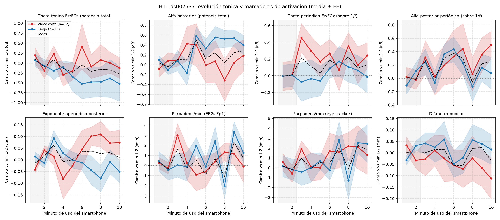

# Reporte H1 · Validación en OpenNeuro ds007537

> **Proyecto:** MIRAI 2026 · Closed-Loop Neuroadaptive AR Platform for Dopamine Scrolling
> **Fecha:** 2026-10-20 · **Script:** `h1_ds007537.py` · **Resultados:** `results/`
> **Estado:** evidencia **preliminar y exploratoria** (sin condición control, n pequeño, sin corrección por comparaciones múltiples).

---

## 1. Resumen

| Parte de H1 | Resultado | Veredicto |
|---|---|---|
| **H1a · alfa posterior tónica ↑** | En **video corto** sube el **ritmo alfa (alfa periódica)**: +0.43 dB en 10/12 sujetos (p = 0.04), pero **no la potencia alfa total**. En **juego** sube la alfa total y aumentan los parpadeos. | **Apoyo parcial y exploratorio** |
| **H1b · theta frontal tónico ↑** | Sin cambio en 10 min, ni en potencia total ni en periódica, en ningún grupo. | **No detectado** |

**Conclusión principal:** durante 10 min de video corto, el ritmo alfa posterior aumenta **sin señales de somnolencia** (parpadeo y pupila estables). El patrón es compatible con un **desenganche cortical (inhibición funcional de la corteza visual)**. Esto **no demuestra fatiga cognitiva**: la habituación, la divagación mental y el simple paso del tiempo explican el mismo resultado mientras no haya condición control ni medidas de fatiga y rendimiento.

---

## 2. Hipótesis evaluada

**H1 (componente tónico de la fatiga cognitiva):** durante el uso continuo del smartphone, la potencia theta frontal-medial (Fz/FCz) y la alfa posterior (Pz/POz/O1/O2), normalizadas a los primeros minutos, aumentan con el tiempo, con un efecto mayor en video corto que en otros usos.

Se divide en **H1a (alfa)** y **H1b (theta)** porque responden a mecanismos distintos (§7.4).

---

## 3. Dataset

| Característica | Valor |
|---|---|
| Fuente | Mishra, Gandhi & Gandhi (2026). OpenNeuro **ds007537** v2.0.2 (CC0) |
| Participantes | 30 registrados → **27 analizados** (se excluyeron sub-22, 23 y 27 por ruido) |
| Grupos (`app_type`) | Video corto **S = 12**, Juego **G = 13**, Lectura R = 2 (solo cuentan en "Todos") |
| EEG | Brain Products actiCHamp, 64 canales, 1000 Hz, referencia Cz |
| Otros | Eye-tracking Tobii Pro Glasses 2 (100 Hz), PPG, GSR, SAS (33 ítems), MPPUS (27 ítems) |
| Protocolo | **10 min** de uso libre del smartphone (S12→S13) → **5 min** de video de naturaleza en monitor (S22→S23), **siempre en ese orden** |

---

## 4. Método

### 4.1 Preprocesado (por sujeto)
1. Recorte del registro (sesión smartphone a video, ±5 s), pasa-banda **1–40 Hz** (elimina la deriva DC y la red de 50 Hz) y remuestreo a **250 Hz**.
2. **Canales rotos** por desviación absoluta mediana (MAD > 5× o < 0.05× la mediana), con **interpolación esférica**. La MAD no confunde parpadeos con canales rotos.
3. **Detección de parpadeos** en (Fp1+Fp2)/2 (§4.3), antes de la ICA.
4. **Referencia promedio** (reconstruye Cz).
5. **ICA infomax** (20 componentes); se eliminan hasta 3 componentes oculares correlacionadas con Fp1/Fp2 (z > 3).
6. **Épocas de 2 s**; se rechazan las de amplitud pico a pico > 150 µV en los canales de interés.

### 4.2 Medidas espectrales (por minuto)
- **Frecuencia alfa individual (IAF):** pico entre 7 y 13 Hz de la región posterior. Bandas: **theta = IAF−6 a IAF−2 Hz** y **alfa = IAF−2 a IAF+2 Hz**. También se calculan las bandas fijas (4–8 y 8–13 Hz) como comprobación.
- **Potencia total (dB):** integral de la PSD en la banda.
- **Potencia periódica (dB sobre 1/f):** con **specparam** (Donoghue et al., 2020) se ajusta el espectro de 2–40 Hz como *fondo aperiódico + picos*, y se mide cuánto sobresale la banda por encima del fondo.
- **Exponente aperiódico:** inclinación del fondo 1/f.

### 4.3 Marcadores de activación (control de somnolencia)
- **Parpadeos/min desde el EEG:** picos en (Fp1+Fp2)/2 filtrado a 1–10 Hz, ancho de 40–500 ms, separación ≥ 300 ms, con **umbral adaptativo por persona** (la mitad de la mediana de sus 20 picos más grandes). *El detector de MNE contaba unas 8 veces de más porque incluía movimientos oculares.*
- **Parpadeos/min y diámetro pupilar desde el eye-tracker**, alineados con los pulsos TTL compartidos con el EEG (65/65 pulsos, error ≤ 2 ms, deriva de ~20 ppm). Se anulan los minutos con más de 20% de pupila perdida.

### 4.4 Estadística
- Normalización: a cada minuto se le resta la media de los **minutos 1–2** del mismo sujeto.
- Por sujeto: **pendiente** (unidades/min, minutos 1–10) y **cambio tardío** (media de minutos 9–10 menos la de minutos 1–2).
- Grupo: t de una muestra y **Wilcoxon** contra 0; Mann-Whitney S vs G; Spearman contra SAS/MPPUS.
- ⚠️ **Sin corrección por comparaciones múltiples** (10 medidas × 3 grupos). Los valores p son exploratorios.

---

## 5. Control de calidad

| Indicador | Resultado |
|---|---|
| Canales interpolados | 7/27 sujetos (1–2 canales; FCz en 3 de ellos) |
| Épocas válidas (smartphone) | ≥ 80% en todos; mediana del 100% |
| Ajuste de specparam | R² mediano > 0.9; **44/269 minutos** con R² < 0.8 en la región posterior (verificación en §6.4) |
| **Validación del detector de parpadeos (EEG vs eye-tracker)** | **ρ = 0.75 por minuto** (249 minutos); **ρ = 0.55 por pendiente** de sujeto (p = 0.004) |
| Pupila válida | 249/269 minutos; 25 sujetos con ≥ 5 min válidos |
| Excluidos | sub-22, 23 y 27: < 40% de épocas válidas en el video y ruido alto en el smartphone |

> **Nota sobre la exclusión:** en el primer análisis (n = 30), la alfa total de video corto parecía subir con fuerza. Ese efecto lo producía sobre todo **sub-22 (+7 dB)**, uno de los registros más ruidosos. Sin los 3 sujetos ruidosos, la alfa total de video corto ya no cambia, y esto llevó a separar la alfa periódica de la total.

---

## 6. Resultados



*Cambio respecto a los minutos 1–2 (franja gris). Rojo = video corto, azul = juego, discontinua = todos. Sombra = error estándar.*

### 6.1 Cambio tardío (minutos 9–10 vs 1–2)

| Medida | Video corto (n = 12) | Juego (n = 13) | Todos (n = 27) |
|---|---|---|---|
| Alfa **total** (IAF) | +0.12 dB · ↑8/12 · p = 0.30 | **+0.47 dB · ↑11/13 · p = 0.013** | +0.27 dB · ↑20/27 · p = 0.026 |
| Alfa **periódica** | **+0.43 dB · ↑10/12 · p = 0.042** | +0.12 dB · ↑8/13 · p = 0.50 | +0.24 dB · ↑18/27 · p = 0.077 |
| Exponente 1/f posterior (pendiente) | **↑10/12 · p = 0.021** | ↑4/13 · p = 0.22 | p = 0.71 |
| Theta **total** (IAF) | −0.06 dB · p = 0.97 | −0.46 dB · p = 0.38 | −0.22 dB · p = 0.71 |
| Theta **periódica** | +0.18 dB · p = 0.42 | +0.03 dB · p = 0.89 | +0.11 dB · p = 0.36 |
| Parpadeos (EEG) | +0.5/min · p = 0.65 | **+2.3/min · p = 0.007** | **+1.5/min · p = 0.019** |
| Parpadeos (eye-tracker) | +1.7/min · p = 0.59 (n = 10) | +2.5/min · p = 0.17 | +2.0/min · p = 0.14 (n = 25) |
| Pupila | −0.09 mm · p = 0.38 (n = 10) | +0.03 mm · p = 0.68 | −0.01 mm · p = 1.0 (n = 25) |

*Valores p de Wilcoxon. ↑k/n = sujetos con cambio positivo. Las bandas fijas (4–8 y 8–13 Hz) dan los mismos resultados que las bandas IAF.*

### 6.2 Diferencias entre grupos
- **Exponente 1/f:** sube en video corto y baja en juego (**Mann-Whitney p = 0.021**). Es la única medida en la que los grupos difieren.
- Alfa y theta: sin diferencia S vs G (p > 0.13).

### 6.3 Cuestionarios
Ninguna pendiente se correlaciona con **SAS** ni con **MPPUS** (|ρ| ≤ 0.33, p ≥ 0.096).

### 6.4 Verificación de robustez de la alfa periódica
Descartando los minutos con R² < 0.8 en specparam: video corto **+0.39 dB, ↑10/12, p = 0.064**. Mantiene la dirección y el número de sujetos, pero **queda en el límite de la significancia**. Es un efecto **frágil**.

---

## 7. Interpretación

### 7.1 Por qué sube la alfa periódica y no la total

El espectro del EEG tiene dos componentes:

```
Potencia
  │\
  │ \           ← fondo aperiódico (1/f): actividad de fondo, no es un ritmo
  │  \    ╱╲
  │   \  ╱  ╲   ← pico alfa (~10 Hz): un ritmo de verdad
  │    \╱    ╲___
  └──────────────────── Frecuencia
```

La **alfa total** mide todo lo que hay entre 8 y 13 Hz: **el pico más el fondo debajo de él**. En video corto ocurrieron dos cambios opuestos:

```
Alfa total  =  ritmo alfa (pico)  +  fondo bajo el pico
   ≈ 0      =       ↑ sube        +       ↓ baja
                 (+0.43 dB)         (el exponente 1/f sube: el fondo se inclina)
```

1. **El ritmo alfa creció** (alfa periódica +0.43 dB).
2. **El fondo 1/f se inclinó más** (sube el exponente): queda menos potencia de fondo en la zona alfa.
3. **Los dos cambios se cancelan** y la alfa total parece plana.

Medir solo la alfa total, como hace la mayoría de los estudios clásicos de fatiga, **habría ocultado el efecto**. Separar ambos componentes es hoy una práctica recomendada (Donoghue et al., 2020).

### 7.2 Qué puede explicar el aumento del ritmo alfa en video corto

**Lo que sí se puede afirmar:** el ritmo alfa posterior es el marcador clásico de **inhibición funcional** de la corteza visual (Klimesch et al., 2007; Jensen & Mazaheri, 2010). Que aumente indica que la corteza visual **reduce su procesamiento activo** del estímulo: un **desenganche cortical**.

**Lo que se descarta en parte:** **somnolencia**. Si el usuario se estuviera durmiendo, aumentarían los parpadeos y bajaría la pupila. En video corto **no cambian** (parpadeo p = 0.65; pupila p = 0.38).

**Lo que no se puede separar todavía:**

| Explicación | Mecanismo | Qué la distinguiría |
|---|---|---|
| **Fatiga cognitiva** (hipótesis del proyecto) | La red de control reduce los recursos asignados; la corteza visual se "apaga" del estímulo | Aumento de **KSS/VAS de fatiga** y **peor rendimiento** en Go/NoGo posterior |
| **Habituación** | El formato deja de ser novedoso y la respuesta visual disminuye | La alfa **se recupera** al cambiar de contenido o de app |
| **Divagación mental** | La atención se vuelve hacia dentro y la alfa posterior sube | Sondeos de experiencia ("¿en qué pensabas?") durante la sesión |
| **Efecto del tiempo** (cualquier tarea) | 10 min de cualquier actividad visual pasiva producen el mismo cambio | **Condición control** de la misma duración (documental) |

Además, el **aumento del exponente 1/f** en video corto se ha asociado a un **desplazamiento del balance excitación/inhibición hacia la inhibición** (Gao et al., 2017). Es coherente con el desenganche, aunque es una inferencia indirecta.

### 7.3 Juego: un patrón distinto
En juego sube la **alfa total** (sobre todo por el fondo, no por el ritmo) y **aumentan los parpadeos** (+2.3/min). Esto se parece más a **baja activación o a automatización de la tarea** (eficiencia neural) que a desenganche. Que los dos grupos difieran en el exponente 1/f (p = 0.021) sugiere que **el tipo de contenido cambia la forma en que el cerebro responde al uso prolongado**.

### 7.4 Por qué no sube theta
1. **Duración:** los estudios de fatiga que reportan theta al alza usan de 30 min a 4 h (Tran et al., 2020). 10 min puede no ser suficiente.
2. **Mecanismo:** el theta frontal tónico refleja el **esfuerzo compensatorio** para mantener el rendimiento (Wascher et al., 2014). El video corto es **pasivo** y no exige rendimiento, así que podría no generar theta aunque haya fatiga.
3. **Hipótesis derivada:** en el consumo pasivo, la fatiga podría expresarse como **desenganche (alfa)** y no como **sobrecarga (theta)**. Hay que plantearla explícitamente y ponerla a prueba.

---

## 8. Limitaciones
1. **Sin condición control:** el video de naturaleza siempre va después del smartphone, así que el cambio no se puede atribuir al scrolling y no simplemente al paso del tiempo.
2. **Duración corta (10 min)** para un constructo de fatiga.
3. **n pequeño** (12 en video corto) y **sin corrección por comparaciones múltiples**: con Bonferroni ningún resultado de video corto sobrevive.
4. **Sin medidas de fatiga ni de rendimiento** (KSS, VAS, Go/NoGo).
5. **Contenido no controlado:** cada participante usó su propia app y sus propios videos.
6. **La pupila depende del brillo** de la pantalla; es una medida de apoyo, no principal.
7. **El eye-tracker pierde la pupila** al mirar el teléfono (hasta 56% de datos perdidos en algunos sujetos); el parpadeo del EEG es más confiable aquí.

---

## 9. Implicaciones para el proyecto
- **Medida principal recomendada:** **alfa periódica** (no la total), junto con el **exponente 1/f**. Ambas son reproducibles con el montaje AURA (`Pz, O1, O2`).
- **Control de somnolencia:** **parpadeos desde Fp1/Fp2**, validados contra el eye-tracker (ρ = 0.75); no requieren hardware extra.
- **Para convertir "desenganche" en "fatiga":** agregar KSS/VAS antes y después, Go/NoGo antes y después, y una **condición control** de la misma duración.
- **Reformular H1:** H1a (alfa periódica) y H1b (theta), con la alternativa explícita de que el scrolling pasivo produzca desenganche sin sobrecarga.

**Formulación para la presentación:**
> En usuarios de video corto, el ritmo alfa posterior (sin el componente 1/f) aumentó tras 10 min en 10 de 12 sujetos (+0.43 dB, p = 0.04, exploratorio), sin cambios en parpadeo ni pupila, lo que es compatible con desenganche cortical y no con somnolencia. Theta tónico no cambió.

---

## 10. Próximos pasos
1. **EEG-SVRec** (piloto de 2–3 sujetos antes de bajarlo completo): réplica dentro de sesiones de 15 min, efecto acumulado entre 4–5 sesiones y **alfa periódica por video vs inmersión reportada**.
2. **Control positivo con Cao 2019** (90 min): verificar que el pipeline detecta theta al alza cuando existe.
3. **Fijar las reglas de análisis** antes de los datos nuevos: medida principal, prueba y corrección.
4. **Experimento propio:** 35 min de scrolling vs 35 min de documental, con KSS/VAS, Go/NoGo y el montaje AURA.

---

## 11. Archivos
| Archivo | Contenido |
|---|---|
| `h1_ds007537.py` | Pipeline completo (uso en el docstring) |
| `results/h1_reporte.txt` | Salida estadística completa |
| `results/h1_por_minuto.csv` | Todas las medidas por sujeto, condición y minuto |
| `results/h1_pendientes.csv` | Pendiente y cambio tardío por sujeto + cuestionarios |
| `results/h1_calidad.csv` | IAF, componentes ICA, canales interpolados, % de épocas válidas, R² mínimo |
| `results/h1_trayectorias.png` | Figura de la §6 |

---

## Referencias
- Donoghue, T., Haller, M., Peterson, E. J., et al. (2020). Parameterizing neural power spectra into periodic and aperiodic components. *Nature Neuroscience, 23*, 1655–1665. https://doi.org/10.1038/s41593-020-00744-x
- Gao, R., Peterson, E. J., & Voytek, B. (2017). Inferring synaptic excitation/inhibition balance from field potentials. *NeuroImage, 158*, 70–78. https://doi.org/10.1016/j.neuroimage.2017.06.078
- Jensen, O., & Mazaheri, A. (2010). Shaping functional architecture by oscillatory alpha activity: Gating by inhibition. *Frontiers in Human Neuroscience, 4*, 186. https://doi.org/10.3389/fnhum.2010.00186
- Klimesch, W., Sauseng, P., & Hanslmayr, S. (2007). EEG alpha oscillations: The inhibition–timing hypothesis. *Brain Research Reviews, 53*(1), 63–88. https://doi.org/10.1016/j.brainresrev.2006.06.003
- Mishra, P., Gandhi, T. K., & Gandhi, S. R. (2026). A multimodal dataset of EEG, eye-tracking, and physiological signals during naturalistic smartphone interactions. *bioRxiv*. https://doi.org/10.64898/2026.04.21.719334 · OpenNeuro ds007537
- Tran, Y., Craig, A., Craig, R., Chai, R., & Nguyen, H. (2020). The influence of mental fatigue on brain activity: Evidence from a systematic review with meta-analyses. *Psychophysiology, 57*(5), e13554. https://doi.org/10.1111/psyp.13554
- Wascher, E., Rasch, B., Sänger, J., et al. (2014). Frontal theta activity reflects distinct aspects of mental fatigue. *Biological Psychology, 96*, 57–65. https://doi.org/10.1016/j.biopsycho.2013.11.010
